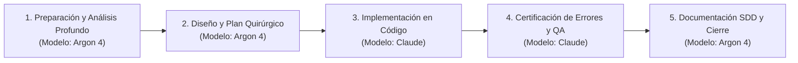

# Gobernanza Multiagente y Multimodelo — Proyecto Skala Venezuela (`catalogo-skala`)

> **Regla Operativa Inquebrantable (Always-On)**
> Este proyecto (`Skala-venezuela` / `catalogo-skala`) se desarrolla en un **entorno multiagente con variaciones de modelos de IA**. Todo agente activo debe respetar estrictamente su rol según el modelo en ejecución.

---

## 1. Regla de Oro de Selección de Modelos

1. **Siempre que se necesite TOCAR CÓDIGO → Usaremos a Claude.**
   - Incluye cualquier creación, modificación o refactorización en:
     - Frontend Web y PWA: `catalogo-skala/*.html`, `catalogo-skala/sw.js`, `catalogo-skala/js/*.js`, `catalogo-skala/css/*.css`.
     - Backend Google Apps Script: `crm/Code.gs`.
     - Base de Datos y RPCs Supabase: `supabase/*.sql`.
     - App Nativa Android: `android/**/*.java`, `android/**/*.kts`, `android/**/*.xml`, `android/*.bat`.
     - Suites de Pruebas: `catalogo-skala/tests/*.js`, `crm/tests/*.js`.
2. **Siempre que CERTIFIQUEMOS / VERIFIQUEMOS ERRORES EN EL CÓDIGO → Usaremos a Claude.**
   - Incluye debugging, caza de bugs, auditoría de vulnerabilidades en código/SQL, creación o ejecución de tests (`node:test`, `Playwright`, `fake-gas.js`) y validación de compilación Android.
3. **Para el RESTO DE TAREAS DE PREPARACIÓN (y Ejecución Full-Stack cuando no esté disponible Claude) → Usaremos a Argon 4 (Gemini 4 Argon).**
   - Incluye investigación profunda del repositorio, análisis de brechas (*Gap Analysis*), diseño arquitectónico, preparación de planes de migración (ej. Google Sheets → Supabase), redacción/actualización de documentación (`SPEC.md`, `MIGRACION.md`, `INSTALAR.md`, `AGENTS.md`, `agent.md`), preparación de prompts quirúrgicos y, **cuando el usuario lo indique explícitamente por no contar con Claude**, implementación directa en código y verificación QA.

---

## 2. Flujo de Trabajo Multiagente para `catalogo-skala`

### Protocolo de Handoff (Entrega de Turno)
- **De Argon 4 a Claude:** Cuando la preparación está lista y se requiere tocar o certificar código, **Argon 4 NO edita archivos de código**; en su lugar, presenta el diagnóstico, la lista exacta de archivos/líneas afectados y el bloque de instrucciones listo para ejecutar con **Claude**.
- **De Claude a Argon 4:** Una vez que **Claude** aplica los cambios en el código y certifica con pruebas que no existen errores ni regresiones, entrega el reporte de verificación (`status`, `artifacts`, `risks`, `next_recommended`).

---

## 3. Contexto Arquitectónico de `Skala-venezuela` (`catalogo-skala`)

- **Propósito:** Plataforma B2B mayorista omnicanal (Catálogo Público Web + Panel PWA Offline-First + App Android Híbrida + Backend CRM) para Distribuidora Ontiveros Only Skala (El Vigía, Mérida, Venezuela).
- **Capas del Sistema:**
  1. **Catálogo Público (`catalogo-skala/index.html`, `js/main.js`, `js/datos.js`, `js/producto.js`, `js/crm.js`):** Vitrina interactiva e imprimible A4, precios al por menor y al mayor (15+ cajas), 4 modalidades de pago con descuento, autocompletado de clientes y envío a `PedidosWeb` + WhatsApp.
  2. **Panel del Equipo PWA (`catalogo-skala/panel.html`, `js/panel.js`, `js/crm-core.js`, `js/crm-api.js`, `sw.js`):** SPA offline-first para los roles `master`, `admin`, `vendedor` y `despachador`. Soporta toma de pedidos con precios personalizados, aprobación/facturación, despacho y entrega con diferencias/notas de crédito, inventario físico vs. disponible, cobros multimoneda (`USD` / `Bs` con tasa BCV histórica), abonos parciales, ajustes de precio en cobranza y liquidación de comisiones.
  3. **Backend Dual (Google Sheets `crm/Code.gs` ↔ Supabase PostgreSQL `supabase/schema.sql`):**
     - **11 tablas de dominio:** `Usuarios`, `Clientes`, `Pedidos`, `PedidoItems`, `Historial`, `Precios`, `Inventario`, `PedidosWeb`, `Config`, `Pagos`, `Tasas` (+ `skala_secretos` en PostgreSQL).
     - **33 acciones de API** con firmas `HMAC-SHA256` y hashes `SHA-256` compatibles entre ambos motores.
  4. **App Android (`android/` — `com.skala.equipo`):** Contenedor `WebViewAssetLoader` + `WorkManager` (`Sincronizador.java` a las 8h, 13h y 16h) + actualizador OTA de pantallas `.zip` y binario `.apk` (`Actualizador.java`).
