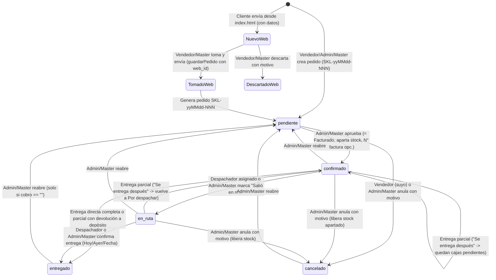
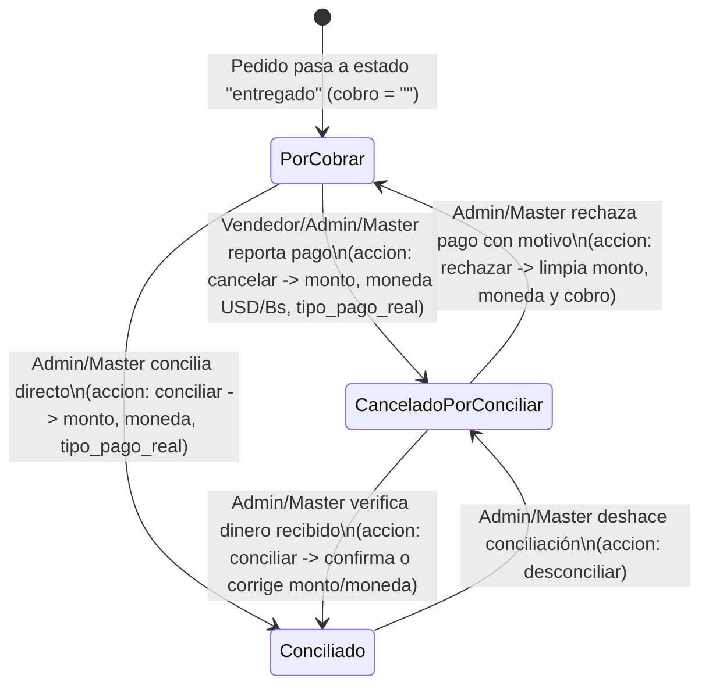

# Especificación del Sistema (SDD) — Catálogo y CRM Skala Venezuela (`catalogo-skala`)

> **Documento de Especificación Formal (Spec-Driven Development)**
> **Repositorio:** `catalogo-skala` (`https://github.com/AdhamDK/catalogo-skala`)
> **Organización / Negocio:** Distribuidora Ontiveros Only Skala (El Vigía, Mérida, Venezuela)
> **Versión del Sistema Analizada:** CRM v3 / Panel v4 / Catálogo 2026 / App Android v1.0.0 (`versionCode = 1`, `sw.js = skala-equipo-v23`)
> **Fecha de Auditoría SDD:** Noviembre 2026

---

## 1. Visión General y Propósito del Sistema

**Skala Venezuela (`catalogo-skala`)** es una plataforma integral **B2B / Mayorista** de exhibición comercial, toma de pedidos omnicanal, gestión de relaciones con clientes (CRM), control de inventario, facturación/despacho y conciliación de cobranzas para el distribuidor autorizado de productos capilares brasileños **Skala** en Venezuela.

El sistema resuelve la operación completa de distribución mayorista en un entorno con **conectividad móvil intermitente** y **economía bimonetaria (USD / Bs)** mediante cuatro pilares operativos:

1. **Catálogo Público Interactivo e Imprimible (`catalogo-skala/index.html`):**
   - Vitrina digital *mobile-first* con estética oficial de Skala Brasil y soporte nativo de impresión/exportación a PDF A4 (`Catalogo-Skala-2026.pdf`).
   - Armador de pedidos mayoristas con cálculo en vivo de niveles de precio (Al por menor vs. Al mayor desde 15 cajas) y 4 esquemas de descuento según modalidad de pago.
   - Autogestión para clientes recurrentes (búsqueda por teléfono o RIF), captura de coordenadas GPS de entrega, envío directo al backend (`PedidosWeb`) y canalización inmediata hacia el WhatsApp del vendedor asignado o de la oficina central.
2. **Panel Operativo del Equipo — PWA Offline-First (`catalogo-skala/panel.html`):**
   - Aplicación web progresiva (SPA por hash `#/...`) para los 4 roles operativos: **Master**, **Administración**, **Vendedor** y **Despachador**.
   - Permite tomar pedidos en calle (con o sin señal, encolando en `localStorage`), administrar la cartera de clientes geolocalizados, aprobar/facturar pedidos, gestionar entregas totales o parciales con cálculo de carga vehicular y notas de crédito, controlar inventario físico vs. disponible y conciliar cobranzas en Dólares (`USD`) y Bolívares (`Bs`).
3. **Backend Serverless sobre Google Workspace (`crm/Code.gs`):**
   - API HTTP JSON (`doGet` / `doPost`) implementada en **Google Apps Script (GAS)** usando una hoja de cálculo de **Google Sheets** en Google Drive como base de datos relacional-tabular de **9 hojas** con bloqueo transaccional (`LockService`), caché de sesiones/rate-limiting (`CacheService`) y firmado criptográfico `HMAC-SHA256`.
4. **Aplicación Nativa Híbrida Android (`android/` — *Skala Equipo*):**
   - Contenedor Android (`minSdk 24`, `targetSdk 34`) basado en `WebViewAssetLoader` + `WorkManager` que empaqueta el panel del equipo, mantiene sesiones de 30 días, sincroniza automáticamente la base de datos en segundo plano a las **08:00, 13:00 y 16:00 h**, y soporta actualizaciones OTA (*Over-The-Air*) tanto del paquete de pantallas (`.zip`) como del binario `.apk` vía GitHub Releases sin depender de Google Play Store.

---

## 2. Arquitectura y Stack Tecnológico

### 2.1. Topología de Componentes

```mermaid
flowchart TB
    subgraph Clientes["Canal Público (Clientes Mayoristas)"]
        CAT["Catálogo Web (index.html)<br/>Vanilla JS + CSS Print/Mobile"]
        WA_CLI["WhatsApp Cliente"]
    end

    subgraph Equipo["Canal Interno (Equipo Skala)"]
        PWA["Panel PWA (panel.html + sw.js)<br/>SPA Hash Router + Offline Queue"]
        APK["App Android (com.skala.equipo)<br/>WebViewAssetLoader + WorkManager"]
        WA_GRP["Grupo WhatsApp Empresa"]
    end

    subgraph Hosting["Distribución Estática y Releases"]
        NET["Netlify CDN<br/>(publish: catalogo-skala/)"]
        GHR["GitHub Releases<br/>(APK + pantallas-VERSION.zip)"]
    end

    subgraph Backend["Backend Serverless (Google Cloud / Workspace)"]
        GAS["Google Apps Script (crm/Code.gs)<br/>Web App /exec (text/plain JSON)"]
        LOCK["LockService & CacheService<br/>(Concurrencia y Rate-Limit)"]
        PROP["PropertiesService<br/>(CRM_SECRET, SPREADSHEET_ID)"]
        SHEETS[("Google Sheets (9 Hojas)<br/>Usuarios, Clientes, Pedidos,<br/>PedidoItems, Precios, Inventario,<br/>PedidosWeb, Config, Historial")]
    end

    NET -->|Sirve estáticos| CAT
    NET -->|Sirve PWA| PWA
    GHR -->|Descarga OTA APK / ZIP| APK
    APK -->|Embebe y ejecuta| PWA

    CAT -->|POST text/plain JSON<br/>catalogo, vendedores, buscarClienteWeb,<br/>pedidoWeb, asignarVendedorWeb| GAS
    CAT -->|wa.me/58...| WA_CLI
    PWA -->|POST text/plain JSON<br/>25 acciones API + Token HMAC| GAS
    APK -->|Sync 8h/13h/16h (Red.java)<br/>action: sincronizar| GAS
    PWA -->|Share API / Puente.compartir()| WA_GRP

    GAS --> LOCK
    GAS --> PROP
    GAS <-->|Lectura / Escritura Tabular| SHEETS
```

### 2.2. Stack Tecnológico por Capa

| Capa | Tecnología / Herramienta | Archivos Clave | Características Técnicas |
| :--- | :--- | :--- | :--- |
| **Catálogo y Panel Web (Frontend)** | HTML5, CSS3 Custom Properties, Vanilla JavaScript (ES2020+, sin bundler ni frameworks) | [index.html](file:///C:/Users/DELL/Documents/Kevin%20Trabajo%20Personal/catalogo-skala/catalogo-skala/index.html), [panel.html](file:///C:/Users/DELL/Documents/Kevin%20Trabajo%20Personal/catalogo-skala/catalogo-skala/panel.html), [styles.css](file:///C:/Users/DELL/Documents/Kevin%20Trabajo%20Personal/catalogo-skala/catalogo-skala/css/styles.css), [panel.css](file:///C:/Users/DELL/Documents/Kevin%20Trabajo%20Personal/catalogo-skala/catalogo-skala/css/panel.css) | Cero dependencias NPM en producción. Diseño *mobile-first*, temas claro/oscuro/auto ([tema.js](file:///C:/Users/DELL/Documents/Kevin%20Trabajo%20Personal/catalogo-skala/catalogo-skala/js/tema.js)), hoja de estilo `@media print` A4. |
| **Lógica de Dominio Compartida** | JavaScript Isomórfico (Browser + CommonJS para Node.js) | [producto.js](file:///C:/Users/DELL/Documents/Kevin%20Trabajo%20Personal/catalogo-skala/catalogo-skala/js/producto.js), [datos.js](file:///C:/Users/DELL/Documents/Kevin%20Trabajo%20Personal/catalogo-skala/catalogo-skala/js/datos.js), [crm-core.js](file:///C:/Users/DELL/Documents/Kevin%20Trabajo%20Personal/catalogo-skala/catalogo-skala/js/crm-core.js), [crm-api.js](file:///C:/Users/DELL/Documents/Kevin%20Trabajo%20Personal/catalogo-skala/catalogo-skala/js/crm-api.js) | Funciones puras exportables vía `module.exports` para pruebas unitarias sin DOM; cliente HTTP con fallback automático a copia local offline (`respuestaLocal`). |
| **PWA & Offline** | Service Worker API + Web App Manifest + `localStorage` | [sw.js](file:///C:/Users/DELL/Documents/Kevin%20Trabajo%20Personal/catalogo-skala/catalogo-skala/sw.js), [manifest.webmanifest](file:///C:/Users/DELL/Documents/Kevin%20Trabajo%20Personal/catalogo-skala/catalogo-skala/manifest.webmanifest) | Estrategia *Stale-While-Revalidate* para 12 activos base (`skala-equipo-v23`); cola persistente de pedidos offline (`skala_cola_v1`). |
| **Backend API & Persistencia** | Google Apps Script (V8 Runtime) + Google Sheets | [crm/Code.gs](file:///C:/Users/DELL/Documents/Kevin%20Trabajo%20Personal/catalogo-skala/crm/Code.gs) | Endpoint único `/exec` que recibe `POST` con `Content-Type: text/plain;charset=utf-8` (evita preflight CORS). Sanitización anti-fórmulas con prefijo `'`. |
| **App Móvil Nativa** | Java 17 + Android SDK 34 + Gradle Kotlin DSL | [MainActivity.java](file:///C:/Users/DELL/Documents/Kevin%20Trabajo%20Personal/catalogo-skala/android/app/src/main/java/com/skala/equipo/MainActivity.java), [Sincronizador.java](file:///C:/Users/DELL/Documents/Kevin%20Trabajo%20Personal/catalogo-skala/android/app/src/main/java/com/skala/equipo/Sincronizador.java), [Actualizador.java](file:///C:/Users/DELL/Documents/Kevin%20Trabajo%20Personal/catalogo-skala/android/app/src/main/java/com/skala/equipo/Actualizador.java), [Puente.java](file:///C:/Users/DELL/Documents/Kevin%20Trabajo%20Personal/catalogo-skala/android/app/src/main/java/com/skala/equipo/Puente.java) | `androidx.core:1.12.0`, `androidx.webkit:1.9.0`, `androidx.work:work-runtime:2.9.0`. Puente JS `window.SkalaApp`. |
| **Testing & QA** | `node:test`, `node:assert`, `vm` (Fake GAS), Playwright | [producto.test.js](file:///C:/Users/DELL/Documents/Kevin%20Trabajo%20Personal/catalogo-skala/catalogo-skala/tests/producto.test.js), [crm-core.test.js](file:///C:/Users/DELL/Documents/Kevin%20Trabajo%20Personal/catalogo-skala/catalogo-skala/tests/crm-core.test.js), [code.test.js](file:///C:/Users/DELL/Documents/Kevin%20Trabajo%20Personal/catalogo-skala/crm/tests/code.test.js), [fake-gas.js](file:///C:/Users/DELL/Documents/Kevin%20Trabajo%20Personal/catalogo-skala/crm/tests/fake-gas.js), [e2e.js](file:///C:/Users/DELL/Documents/Kevin%20Trabajo%20Personal/catalogo-skala/catalogo-skala/tests/e2e.js), [e2e-panel.js](file:///C:/Users/DELL/Documents/Kevin%20Trabajo%20Personal/catalogo-skala/catalogo-skala/tests/e2e-panel.js), [e2e-app.js](file:///C:/Users/DELL/Documents/Kevin%20Trabajo%20Personal/catalogo-skala/catalogo-skala/tests/e2e-app.js) | Emulador en memoria de Google Apps Script ([fake-gas.js](file:///C:/Users/DELL/Documents/Kevin%20Trabajo%20Personal/catalogo-skala/crm/tests/fake-gas.js)) y pruebas E2E multi-viewport y multi-rol. |
| **Despliegue** | Netlify + Scripts `.bat` Windows | [netlify.toml](file:///C:/Users/DELL/Documents/Kevin%20Trabajo%20Personal/catalogo-skala/netlify.toml), [compilar_apk.bat](file:///C:/Users/DELL/Documents/Kevin%20Trabajo%20Personal/catalogo-skala/android/compilar_apk.bat), [hacer_pantallas.bat](file:///C:/Users/DELL/Documents/Kevin%20Trabajo%20Personal/catalogo-skala/android/hacer_pantallas.bat) | Publicación continua desde rama `main` (`publish = "catalogo-skala"`). |

---

## 3. Especificación de Datos y Modelos de Dominio

### 3.1. Inventario Cuantitativo de Archivos y Activos del Repositorio

El repositorio consta de **115 archivos** (excluyendo `.git`), totalizando **24.64 MB (25,839,507 bytes)**:

| Subsistema / Categoría | Cantidad de Archivos | Tamaño Total | Detalle de Contenido |
| :--- | :---: | :---: | :--- |
| **Imágenes PNG Originales (`assets/img/*.png`)** | 20 | 14.59 MB (15,312,345 B) | 11 Baños (`BC-01`..`BC-11`), 8 Kits (`KT-01`..`KT-08`) y `logo.png`. |
| **Imágenes WebP Optimizadas (`assets/img/web/*.webp`)** | 38 | 847.7 KB (868,070 B) | Pares `-400.webp` y `-800.webp` para los 19 productos base (**reducción de peso del 94.2%** respecto a PNG). |
| **Logos y Activos PWA/Android (`*.png`, `*.jpg`)** | 15 | 661.2 KB (677,090 B) | 4 iconos PWA (`logo-96`, `192`, `512`, `maskable-512`), 1 `Skala logo.jpg` y 10 iconos Android `mipmap-*`. |
| **Catálogo Imprimible PDF (`Catalogo-Skala-2026.pdf`)** | 1 | 7.89 MB (8,275,320 B) | Exportación PDF lista para distribución offline. |
| **Capturas Residuales en Raíz Publicada (`elegido.png`, `form.png`)** | 2 | 318.3 KB (325,894 B) | Capturas de prueba en `catalogo-skala/` no referenciadas por el código. |
| **Código Fuente Frontend (`catalogo-skala/js/`, `css/`, `*.html`)** | 14 | 401.9 KB (411,558 B) | `panel.js` (189.2 KB / 2,723 líneas), `styles.css` (58.7 KB), `panel.css` (45.5 KB), `main.js` (33.9 KB), `crm-core.js` (29.0 KB), etc. |
| **Código Fuente Backend (`crm/Code.gs`)** | 1 | 94.5 KB (96,749 B) | 1,730 líneas de Google Apps Script. |
| **Código Fuente Android (`android/`)** | 21 | 88.2 KB (90,347 B) | 7 clases Java (27.4 KB), scripts `.bat`, configuración Gradle y recursos XML + `gradle-wrapper.jar` (43.5 KB). |
| **Suite de Pruebas (`tests/`)** | 7 | 209.3 KB (214,298 B) | `code.test.js` (78.2 KB), `e2e-panel.js` (65.4 KB), `crm-core.test.js` (29.5 KB), `e2e.js` (25.5 KB), `e2e-app.js` (8.0 KB), `fake-gas.js` (4.8 KB), `producto.test.js` (2.9 KB). |
| **Documentación y Configuración** | 6 | 33.7 KB (34,538 B) | `README.md` (raíz y catálogo), `crm/INSTALAR.md`, `android/LEEME.md`, `docs/specs/modo-vendedor-crm.md`, `netlify.toml`. |

---

### 3.2. Catálogo Estático de Productos Base ([`catalogo-skala/js/datos.js`](file:///C:/Users/DELL/Documents/Kevin%20Trabajo%20Personal/catalogo-skala/catalogo-skala/js/datos.js))

El sistema define **19 productos base** divididos en 2 categorías (`BANOS` con 11 ítems y `KITS` con 8 ítems), sincronizados con `PRODUCTOS_BASE` en [`crm/Code.gs`](file:///C:/Users/DELL/Documents/Kevin%20Trabajo%20Personal/catalogo-skala/crm/Code.gs#L66-L72). Además, permite agregar productos dinámicos desde la hoja `Precios` mediante [`sumarProductosNuevos()`](file:///C:/Users/DELL/Documents/Kevin%20Trabajo%20Personal/catalogo-skala/catalogo-skala/js/datos.js#L54-L71).

#### A. Estructura de Entidad de Producto en Cliente (`BANOS` / `KITS`)

| Atributo | Tipo | Origen | Descripción y Reglas |
| :--- | :--- | :--- | :--- |
| `code` | `string` | Estático / CRM | Código SKU único (`BC-01`..`BC-11`, `KT-01`..`KT-08`, o autogenerado `BC-12+` / `KT-09+`). |
| `name` | `string` | Estático / CRM | Nombre comercial del producto (máx. 80 caracteres en alta dinámica). |
| `line` | `string` | Estático / CRM | Línea o beneficio principal: `Hidratación`, `Nutrición`, `Definición`, `Reconstrucción`, `Kids`, `Completo`. |
| `benefit` | `string` | Estático / CRM | Descripción corta del beneficio capilar (máx. 200 caracteres). |
| `hair` | `string` | Estático / CRM | Rango de curvatura objetivo en formato `[1-4][A-C]–[1-4][A-C]` (ej. `1A–4C`, `3A–4C`). Parseado por [`tiposDeCabello()`](file:///C:/Users/DELL/Documents/Kevin%20Trabajo%20Personal/catalogo-skala/catalogo-skala/js/producto.js#L22-L30). |
| `stock` | `number` | Estático (Legacy) | Valor numérico estático en `datos.js` (no utilizado en el render actual; reemplazado por stock dinámico del CRM). |
| `unidades` | `number` | Derivado / CRM | Cantidad de piezas por caja: `6` por defecto (`UNIDADES_POR_CAJA_BANO = 6`, `DUOS_POR_CAJA_KIT = 6`). |
| `unidad` | `string` | Derivado | `"unidades"` para Baños de crema (potes de 1 kg) y `"dúos"` para Kits (shampoo + acondicionador). |
| `nuevo` | `boolean?` | Dinámico CRM | `true` si el producto fue creado desde el panel administrativo y no pertenece a los 19 productos base. |
| `foto` | `string?` | Dinámico CRM | URL `https://...` de imagen externa para productos nuevos (si falta, [`fotoVacia()`](file:///C:/Users/DELL/Documents/Kevin%20Trabajo%20Personal/catalogo-skala/catalogo-skala/js/datos.js#L74-L80) genera un SVG data-URI). |

#### B. Matriz Completa de los 19 Productos Base y sus Activos

| Código | Categoría | Nombre (`name`) | Línea (`line`) | Curvatura (`hair`) | Curvaturas Cubiertas | Presentación por Caja | Stock Estático (`datos.js`) | Peso PNG | Peso WebP (400w / 800w) |
| :--- | :--- | :--- | :--- | :---: | :--- | :--- | :---: | :---: | :---: |
| `BC-01` | Baño de crema | Babosa | Hidratación | `1A–4C` | Liso, Ondulado, Cacheado, Crespo | 6 unidades (1 kg) | 100 | 902.3 KB | 15.0 KB / 37.1 KB |
| `BC-02` | Baño de crema | Banana e Macuri | Nutrición | `1A–4C` | Liso, Ondulado, Cacheado, Crespo | 6 unidades (1 kg) | 100 | 744.9 KB | 13.1 KB / 32.1 KB |
| `BC-03` | Baño de crema | Divino Potao | Hidratación | `1A–4C` | Liso, Ondulado, Cacheado, Crespo | 6 unidades (1 kg) | 100 | 852.6 KB | 13.2 KB / 34.0 KB |
| `BC-04` | Baño de crema | Divino Potinho Kids | Kids | `1A–3C` | Liso, Ondulado, Cacheado | 6 unidades (1 kg) | 100 | 874.2 KB | 14.0 KB / 35.9 KB |
| `BC-05` | Baño de crema | Dona Skala | Hidratación | `1A–4C` | Liso, Ondulado, Cacheado, Crespo | 6 unidades (1 kg) | 200 | 966.2 KB | 16.8 KB / 41.4 KB |
| `BC-06` | Baño de crema | Mais Cachos | Definición | `3A–4C` | Cacheado, Crespo | 6 unidades (1 kg) | 600 | 630.3 KB | 12.0 KB / 29.9 KB |
| `BC-07` | Baño de crema | Mais Crespinhos | Definición | `3A–4C` | Cacheado, Crespo | 6 unidades (1 kg) | 300 | 756.5 KB | 14.1 KB / 36.1 KB |
| `BC-08` | Baño de crema | Mais Crespos | Definición | `4A–4C` | Crespo | 6 unidades (1 kg) | 50 | 635.1 KB | 11.3 KB / 28.3 KB |
| `BC-09` | Baño de crema | Mais Lisos | Hidratación | `1A–2C` | Liso, Ondulado | 6 unidades (1 kg) | 200 | 822.0 KB | 14.6 KB / 36.1 KB |
| `BC-10` | Baño de crema | Potao de Amor | Nutrición | `1A–4C` | Liso, Ondulado, Cacheado, Crespo | 6 unidades (1 kg) | 300 | 821.9 KB | 14.7 KB / 35.7 KB |
| `BC-11` | Baño de crema | Potao Despaiado | Nutrición | `1A–4C` | Liso, Ondulado, Cacheado, Crespo | 6 unidades (1 kg) | 200 | 796.9 KB | 12.8 KB / 33.4 KB |
| `KT-01` | Kit | Kit 12 em 1 | Completo | `1A–4C` | Liso, Ondulado, Cacheado, Crespo | 6 dúos (Sh+Ac) | 40 | 492.1 KB | 8.6 KB / 19.8 KB |
| `KT-02` | Kit | Kit Aguacate | Nutrición | `1A–4C` | Liso, Ondulado, Cacheado, Crespo | 6 dúos (Sh+Ac) | 40 | 487.8 KB | 8.2 KB / 19.4 KB |
| `KT-03` | Kit | Kit Babosa | Hidratación | `1A–4C` | Liso, Ondulado, Cacheado, Crespo | 6 dúos (Sh+Ac) | 10 | 738.5 KB | 12.8 KB / 31.6 KB |
| `KT-04` | Kit | Kit Bomba de Vitaminas S.O.S | Reconstrucción | `1A–4C` | Liso, Ondulado, Cacheado, Crespo | 6 dúos (Sh+Ac) | 60 | 508.3 KB | 8.7 KB / 21.1 KB |
| `KT-05` | Kit | Kit Ceramidas | Reconstrucción | `1A–4C` | Liso, Ondulado, Cacheado, Crespo | 6 dúos (Sh+Ac) | 40 | 514.1 KB | 9.0 KB / 21.3 KB |
| `KT-06` | Kit | Kit Crespo Divino | Definición | `3A–4C` | Cacheado, Crespo | 6 dúos (Sh+Ac) | 40 | 640.2 KB | 9.6 KB / 24.3 KB |
| `KT-07` | Kit | Kit Mais Crespinhos | Definición | `3A–4C` | Cacheado, Crespo | 6 dúos (Sh+Ac) | 10 | 749.8 KB | 11.5 KB / 27.7 KB |
| `KT-08` | Kit | Kit Mais Cachos | Definición | `3A–4C` | Cacheado, Crespo | 6 dúos (Sh+Ac) | 10 | 703.0 KB | 11.0 KB / 25.8 KB |

**Estadísticas Agregadas del Catálogo Base:**
- **Total de SKUs Base:** 19 (11 Baños de crema = 57.9%; 8 Kits = 42.1%).
- **Distribución por Línea (`line`):**
  - `Definición`: 6 productos (3 Baños: `BC-06`, `BC-07`, `BC-08` + 3 Kits: `KT-06`, `KT-07`, `KT-08`).
  - `Hidratación`: 5 productos (4 Baños: `BC-01`, `BC-03`, `BC-05`, `BC-09` + 1 Kit: `KT-03`).
  - `Nutrición`: 4 productos (3 Baños: `BC-02`, `BC-10`, `BC-11` + 1 Kit: `KT-02`).
  - `Reconstrucción`: 2 productos (0 Baños + 2 Kits: `KT-04`, `KT-05`).
  - `Kids`: 1 producto (`BC-04`).
  - `Completo`: 1 producto (`KT-01`).
- **Distribución por Curvatura (`hair`):**
  - `1A–4C` (Todo tipo de cabello): 11 productos (6 Baños + 5 Kits).
  - `3A–4C` (Cacheado y Crespo): 5 productos (2 Baños + 3 Kits).
  - `1A–3C` (Liso, Ondulado, Cacheado): 1 producto (`BC-04`).
  - `1A–2C` (Liso y Ondulado): 1 producto (`BC-09`).
  - `4A–4C` (Solo Crespo): 1 producto (`BC-08`).
- **Suma de Stock Estático (`datos.js`):** 2,500 cajas (2,250 cajas de Baños = 13,500 unidades de 1 kg; 250 cajas de Kits = 1,500 dúos).

---

### 3.3. Esquema de Base de Datos en Google Sheets ([`crm/Code.gs`](file:///C:/Users/DELL/Documents/Kevin%20Trabajo%20Personal/catalogo-skala/crm/Code.gs#L77-L113))

El backend define en el objeto `HOJAS` exactamente **9 hojas (tablas)** que suman **128 columnas**. Todos los strings no vacíos se escriben anteponiendo un apóstrofo (`'`) mediante [`celda_(v)`](file:///C:/Users/DELL/Documents/Kevin%20Trabajo%20Personal/catalogo-skala/crm/Code.gs#L225-L229) para forzar formato texto en Google Sheets, evitando la pérdida de ceros a la izquierda en teléfonos (`0412...`), mutación de fechas y ataques de inyección de fórmulas (`=`, `+`, `-`, `@`).

#### Diagrama Entidad-Relación (Mermaid ER)

```mermaid
erDiagram
    USUARIOS ||--o{ CLIENTES : "registra (vendedor_id)"
    USUARIOS ||--o{ PEDIDOS : "vende (vendedor_id)"
    USUARIOS ||--o{ PEDIDOS : "despacha (despachador_id)"
    USUARIOS ||--o{ PEDIDOS_WEB : "asignado (vendedor_id)"
    CLIENTES ||--o{ PEDIDOS : "solicita (cliente_id)"
    CLIENTES ||--o{ PEDIDOS_WEB : "identifica (cliente_id)"
    PEDIDOS ||--|{ PEDIDO_ITEMS : "contiene (pedido_id)"
    PEDIDOS ||--o{ HISTORIAL : "audita (pedido_id)"
    PEDIDOS_WEB ||--o| PEDIDOS : "se convierte en (web_id / pedido_id)"
    PRECIOS ||--o{ PEDIDO_ITEMS : "define SKU y precios (code)"
    PRECIOS ||--o{ INVENTARIO : "controla stock (code)"

    USUARIOS {
        string id PK "Ej: U1, U2 o V1 (migrado)"
        string usuario UK "Minúsculas sin acentos (3-30 chars)"
        string nombre "Nombre visible"
        string rol "CSV: master, admin, vendedor, despachador"
        string pin_hash "SHA-256(CRM_SECRET|id|clave)"
        boolean activo "true / false"
        string created_at "ISO-8601 UTC"
        string telefono "WhatsApp del vendedor"
    }

    CLIENTES {
        string id PK "UUID v4"
        string nombre "Nombre del negocio o cliente"
        string rif_cedula "RIF o Cédula en mayúsculas"
        string direccion "Dirección física (máx 250 chars)"
        number latitud "Grados decimales [-90, 90]"
        number longitud "Grados decimales [-180, 180]"
        string telefono "Teléfono principal (>= 7 dígitos)"
        string updated_at "ISO-8601 UTC"
        number sync_status "1 (compatibilidad GPS_CLIENTES)"
        number deleted "0 activo, 1 borrado"
        string contacto "Persona de contacto"
        string telefono2 "Teléfono secundario"
        string vendedor_id FK "ID del usuario creador"
        string created_at "ISO-8601 UTC"
    }

    PEDIDOS {
        string id PK "SKL-AAMMDD-NNN"
        string fecha "yyyy-MM-dd HH:mm (America/Caracas)"
        string vendedor_id FK "ID usuario vendedor"
        string vendedor "Nombre vendedor (desnormalizado)"
        string cliente_id FK "UUID cliente"
        string cliente "Contacto/Nombre cliente"
        string negocio "Nombre negocio"
        number total_cajas "Suma de cajas activas"
        string detalle_unidades "Ej: 12 unidades + 6 dúos"
        string pago "Nombre modalidad de pago"
        string nota "Observaciones (máx 300 chars)"
        string estado "pendiente|confirmado|en_ruta|entregado|cancelado"
        string estado_at "ISO-8601 último cambio estado"
        string estado_por "Nombre usuario cambio estado"
        string motivo "Motivo de anulación"
        string client_ref UK "UUID idempotencia cliente"
        string created_at "ISO-8601 UTC"
        string updated_at "ISO-8601 UTC"
        string despachador_id FK "ID usuario despachador (opcional)"
        string despachador "Nombre despachador"
        string confirmado_por "Usuario que aprobó/facturó"
        string confirmado_at "ISO-8601 aprobación"
        string entregado_por "Usuario que entregó"
        string entregado_at "ISO-8601 entrega efectiva"
        string documento "Nota de entrega | Factura"
        number dias_credito "0 o 1..180 días"
        string cobro "vacío | cancelado | conciliado"
        string cobrado_at "ISO-8601 reporte cobro"
        string cobrado_por "Usuario que reportó cobro"
        string conciliado_at "ISO-8601 conciliación"
        string conciliado_por "Usuario que concilió"
        number monto "Monto cobrado (>0, 2 dec)"
        string moneda "USD | Bs"
        string nivel_precio "menor | mayor"
        boolean excepcion_precio "true si mayor con <15 cajas"
        string tipo_pago "credito|pronto|efectivo_credito|efectivo_pronto"
        number total "Total acordado en USD"
        string tipo_pago_real "Modalidad real al cobrar"
        number total_final "Total recalculado al cobrar en USD"
        string web_id FK "ID PedidosWeb origen (WEB-XXXXXX)"
        boolean borrado "Soft-delete (true/vacío)"
        string borrado_motivo "Motivo de borrado"
        string borrado_por "Usuario que borró"
        string borrado_at "ISO-8601 borrado"
        string factura "Número de factura fiscal"
        number nota_credito "Monto USD nota de crédito por devolución"
    }

    PEDIDO_ITEMS {
        string pedido_id FK "SKL-AAMMDD-NNN"
        string code FK "Código SKU (BC-01, KT-01...)"
        string producto "Nombre producto"
        number cajas "Cantidad de cajas facturadas"
        number unidades_caja "Unidades o dúos por caja (6)"
        string unidad "unidades | dúos"
        number total_unidades "cajas * unidades_caja"
        number precio "Precio base unitario USD congelado"
        number desc_pronto "Rebaja USD por caja pronto pago"
        number desc_efectivo_credito "Rebaja USD por caja ef. crédito"
        number desc_efectivo_pronto "Rebaja USD por caja ef. pronto"
        number entregadas "Cajas entregadas acumuladas"
        number devueltas "Cajas devueltas al depósito"
    }

    PRECIOS {
        string code PK "SKU (BC-01..KT-08 o nuevos)"
        string producto "Nombre del producto"
        number menor "Precio final USD Menor Crédito"
        number mayor "Precio final USD Mayor Crédito"
        number pronto "Precio final USD Menor Pronto"
        number efectivo_credito "Precio final USD Menor Ef. Crédito"
        number efectivo_pronto "Precio final USD Menor Ef. Pronto"
        string updated_at "ISO-8601 UTC"
        string updated_por "Usuario que actualizó"
        string tipo "banos | kits (productos nuevos)"
        string linea "Línea capilar (productos nuevos)"
        string beneficio "Beneficio (productos nuevos)"
        string cabello "Curvatura ej. 1A–4C"
        number unidades_caja "Unidades por caja (def. 6)"
        string imagen "URL https:// foto (productos nuevos)"
        number mayor_pronto "Precio final USD Mayor Pronto"
        number mayor_efectivo_credito "Precio final USD Mayor Ef. Crédito"
        number mayor_efectivo_pronto "Precio final USD Mayor Ef. Pronto"
    }

    INVENTARIO {
        string fecha "ISO-8601 UTC"
        string code FK "SKU producto"
        string producto "Nombre producto"
        number cajas "Delta de cajas (+entrada, +/-ajuste, +/-conteo, 0 alta/sobrante)"
        string tipo "entrada | conteo | ajuste | alta | sobrante"
        string nota "Observación o detalle automático"
        string usuario "Nombre usuario ejecutor"
    }

    PEDIDOS_WEB {
        string id PK "WEB-XXXXXX"
        string fecha "yyyy-MM-dd HH:mm"
        string created_at "ISO-8601 UTC"
        string vendedor_id FK "ID vendedor elegido (opcional)"
        string vendedor "Nombre vendedor elegido"
        string negocio "Nombre negocio cliente"
        string contacto "Persona contacto"
        string rif_cedula "RIF / Cédula"
        string telefono "Teléfono cliente"
        string direccion "Dirección entrega"
        string items "JSON Array de ítems"
        string tipo_pago "credito|pronto|efectivo_credito|efectivo_pronto"
        number total_cajas "Suma cajas"
        number total "Total estimado USD"
        string nota "Nota del cliente"
        string estado "nuevo | tomado | descartado"
        string pedido_id FK "ID Pedido SKL generado al tomar"
        string atendido_por "Nombre usuario que tomó/descartó"
        string atendido_at "ISO-8601 atención"
        string motivo "Motivo de descarte"
        string cliente_id FK "UUID si se buscó en Clientes"
        number latitud "Latitud GPS"
        number longitud "Longitud GPS"
    }

    HISTORIAL {
        string fecha "ISO-8601 UTC"
        string pedido_id FK "SKL-AAMMDD-NNN"
        string usuario "Nombre (Roles)"
        string accion "Evento auditado"
        string detalle "Descripción del cambio"
    }

    CONFIG {
        string clave PK "version_apk, url_apk, minima_apk, version_pantallas, url_pantallas, notas"
        string valor "Valor de configuración"
        string nota "Descripción de ayuda"
    }
```



---

### 3.4. Diccionario Exhaustivo de Datos (Google Sheets)

#### 3.4.1. Hoja `Usuarios` (8 columnas)
Almacena las credenciales y permisos del personal de Skala.
1. `id` (`string`, PK): Identificador secuencial (`U1`, `U2`, ...) o heredado de la migración v1 (`V1`, `V2`).
2. `usuario` (`string`, UK): Nombre de usuario normalizado en minúsculas sin tildes (`[a-z0-9._-]{3,30}`).
3. `nombre` (`string`): Nombre visible del miembro del equipo (máx. 60 caracteres).
4. `rol` (`string`): Uno o varios roles separados por coma (`master`, `admin`, `vendedor`, `despachador`). El orden de jerarquía es `master > admin > vendedor > despachador`.
5. `pin_hash` (`string`): Hash hexadecimal SHA-256 de `CRM_SECRET + "|" + id + "|" + clave`.
6. `activo` (`boolean`): Indica si el usuario puede iniciar sesión y operar (`true`, `1`, `si`, `sí`).
7. `created_at` (`string`): Timestamp ISO-8601 de creación.
8. `telefono` (`string`): Número telefónico de WhatsApp del vendedor (opcional, mín. 7 dígitos si se indica) para recibir pedidos desde el catálogo público.

#### 3.4.2. Hoja `Clientes` (14 columnas)
Las primeras 10 columnas mantienen compatibilidad posicional estricta con el sistema externo `GPS_CLIENTES`.
1. `id` (`string`, PK): UUID v4 generado por `Utilities.getUuid()`.
2. `nombre` (`string`): Nombre comercial del negocio (o nombre del contacto si no se especificó negocio; máx. 120 chars).
3. `rif_cedula` (`string`): RIF o cédula en mayúsculas (máx. 30 chars; obligatorio ≥ 6 dígitos si solicita `Factura`).
4. `direccion` (`string`): Dirección física de entrega (máx. 250 chars).
5. `latitud` (`number | ""`): Coordenada GPS redondeada a 6 decimales (`[-90, 90]`).
6. `longitud` (`number | ""`): Coordenada GPS redondeada a 6 decimales (`[-180, 180]`).
7. `telefono` (`string`): Teléfono principal (obligatorio en pedidos, mín. 7 dígitos; opcional en alta manual de traspaso).
8. `updated_at` (`string`): Timestamp ISO-8601 de última modificación.
9. `sync_status` (`number`): Fijado a `1` en cada alta o edición para sincronización con `GPS_CLIENTES`.
10. `deleted` (`number`): Borrado lógico (`0` activo, `1` eliminado).
11. `contacto` (`string`): Nombre de la persona de contacto (máx. 120 chars).
12. `telefono2` (`string`): Teléfono secundario. Si un cliente existente es actualizado mediante pedido con un número distinto al principal, el número antiguo se preserva en `telefono` y el nuevo se guarda automáticamente en `telefono2`.
13. `vendedor_id` (`string`, FK): `id` del usuario que registró originalmente al cliente.
14. `created_at` (`string`): Timestamp ISO-8601 de alta inicial.

#### 3.4.3. Hoja `Pedidos` (45 columnas)
Tabla central transaccional del ciclo de vida de ventas, despacho y cobranza.
1. `id` (`string`, PK): Código correlativo diario en zona `America/Caracas` con formato `SKL-yyMMdd-NNN` (ej. `SKL-261025-001`).
2. `fecha` (`string`): Fecha/hora local legible `yyyy-MM-dd HH:mm` (`America/Caracas`).
3. `vendedor_id` (`string`, FK): `id` del usuario que creó el pedido.
4. `vendedor` (`string`): Nombre del vendedor en el momento de creación.
5. `cliente_id` (`string`, FK): UUID del cliente en la hoja `Clientes`.
6. `cliente` (`string`): Nombre de la persona de contacto o cliente.
7. `negocio` (`string`): Nombre del establecimiento comercial.
8. `total_cajas` (`number`): Suma total de cajas del pedido (se recalcula si se edita o si hay devoluciones al entregar).
9. `detalle_unidades` (`string`): Resumen agregado por tipo de unidad (ej. `"12 unidades + 6 dúos"`).
10. `pago` (`string`): Etiqueta legible de la forma de pago (`"Crédito"`, `"Pronto pago"`, `"Efectivo a crédito"`, `"Efectivo pronto pago"` o texto libre legacy).
11. `nota` (`string`): Observaciones del pedido (máx. 300 chars).
12. `estado` (`string`): Estado operativo (`pendiente`, `confirmado`, `en_ruta`, `entregado`, `cancelado`).
13. `estado_at` (`string`): Timestamp ISO-8601 del último cambio de estado.
14. `estado_por` (`string`): Nombre del usuario que ejecutó el último cambio de estado.
15. `motivo` (`string`): Motivo obligatorio cuando `estado === "cancelado"` (máx. 200 chars).
16. `client_ref` (`string`, UK): UUID generado en el cliente para garantizar idempotencia ante reintentos de red o subida de cola offline.
17. `created_at` (`string`): Timestamp ISO-8601 de creación.
18. `updated_at` (`string`): Timestamp ISO-8601 de última actualización.
19. `despachador_id` (`string`, FK): `id` del despachador asignado (opcional; si queda vacío, despacha Administración).
20. `despachador` (`string`): Nombre del despachador asignado.
21. `confirmado_por` (`string`): Nombre del usuario de Administración/Master que aprobó el pedido.
22. `confirmado_at` (`string`): Timestamp ISO-8601 de aprobación.
23. `entregado_por` (`string`): Nombre del usuario que registró la entrega final.
24. `entregado_at` (`string`): Timestamp ISO-8601 de entrega (puede ser la hora actual o las `16:00:00Z` / `12:00 Caracas` de una fecha retroactiva elegida entre la fecha del pedido y hoy).
25. `documento` (`string`): Tipo de documento fiscal requerido (`"Nota de entrega"` o `"Factura"`).
26. `dias_credito` (`number`): Plazo de crédito en días (`1` a `180` si la modalidad de pago es a crédito; `0` si es pronto pago/contado).
27. `cobro` (`string`): Estado de cobranza (`""` = por cobrar, `"cancelado"` = cobrado por vendedor pendiente de conciliar, `"conciliado"` = dinero verificado por Administración).
28. `cobrado_at` (`string`): Timestamp ISO-8601 de reporte de cobro.
29. `cobrado_por` (`string`): Nombre del usuario que reportó el cobro.
30. `conciliado_at` (`string`): Timestamp ISO-8601 de conciliación administrativa.
31. `conciliado_por` (`string`): Nombre del usuario que concilió el cobro.
32. `monto` (`number | ""`): Monto numérico efectivamente cobrado/recibido (`> 0`, hasta 2 decimales).
33. `moneda` (`string`): Moneda del monto cobrado (`"USD"` o `"Bs"`).
34. `nivel_precio` (`string`): Nivel tarifario aplicado (`"menor"` o `"mayor"`).
35. `excepcion_precio` (`boolean`): `true` si el vendedor otorgó precio `"mayor"` en un pedido de menos de 15 cajas.
36. `tipo_pago` (`string`): Clave normalizada de modalidad de pago acordada (`credito`, `pronto`, `efectivo_credito`, `efectivo_pronto`).
37. `total` (`number | ""`): Monto total acordado en USD según `tipo_pago` y precios congelados de los ítems.
38. `tipo_pago_real` (`string`): Modalidad real con la que pagó el cliente al momento del cobro (permite recalcular descuentos si acordó crédito y pagó en efectivo, o viceversa).
39. `total_final` (`number | ""`): Monto total recalculado en USD según `tipo_pago_real`.
40. `web_id` (`string`, FK): Referencia `WEB-XXXXXX` si el pedido se originó desde `PedidosWeb`.
41. `borrado` (`boolean | ""`): Flag de borrado lógico (`true` oculta el pedido de listas, métricas y reservas de stock).
42. `borrado_motivo` (`string`): Motivo obligatorio al borrar un pedido (máx. 200 chars).
43. `borrado_por` (`string`): Nombre del usuario que borró el pedido.
44. `borrado_at` (`string`): Timestamp ISO-8601 del borrado.
45. `factura` (`string`): Número de factura fiscal cargado opcionalmente al aprobar o editar (máx. 40 chars).
46. *(Nota: `factura` es la col. 44 y `nota_credito` la col. 45)* `nota_credito` (`number | ""`): Monto acumulado en USD de nota de crédito generada cuando el cliente devuelve cajas al depósito durante una entrega con diferencias.

#### 3.4.4. Hoja `PedidoItems` (13 columnas)
Detalle de líneas de producto por pedido. Congela precios y descuentos al momento de creación.
1. `pedido_id` (`string`, FK): Referencia a `Pedidos.id` (si un pedido se edita y reduce líneas, las filas sobrantes se limpian con `pedido_id: ""`).
2. `code` (`string`, FK): Código SKU del producto (`BC-01`, etc.).
3. `producto` (`string`): Nombre del producto.
4. `cajas` (`number`): Cantidad de cajas activas en el pedido (`1..10000`).
5. `unidades_caja` (`number | ""`): Unidades o dúos por caja (`6`).
6. `unidad` (`string`): `"unidades"` o `"dúos"`.
7. `total_unidades` (`number | ""`): `cajas * unidades_caja`.
8. `precio` (`number`): Precio base por caja en USD (modalidad `credito`) según el `nivel_precio` del pedido.
9. `desc_pronto` (`number`): Descuento en USD por caja para modalidad `pronto`.
10. `desc_efectivo_credito` (`number`): Descuento en USD por caja para modalidad `efectivo_credito`.
11. `desc_efectivo_pronto` (`number`): Descuento en USD por caja para modalidad `efectivo_pronto`.
12. `entregadas` (`number`): Cantidad acumulada de cajas ya recibidas por el cliente (soporte de entregas parciales).
13. `devueltas` (`number`): Cantidad acumulada de cajas no recibidas que retornaron al depósito (`destino: "devuelve"`).

#### 3.4.5. Hoja `Precios` (18 columnas)
 Almacena la matriz de **8 precios finales en USD por caja** para cada producto, además de los metadatos de catálogo para productos nuevos.
1. `code` (`string`, PK): Código SKU (`BC-01`..`KT-08`, o nuevos `BC-12+`, `KT-09+`).
2. `producto` (`string`): Nombre del producto.
3. `menor` (`number`): Precio final USD al por menor (< 15 cajas) en modalidad **Crédito (Base)**.
4. `mayor` (`number`): Precio final USD al mayor (≥ 15 cajas) en modalidad **Crédito (Base)**.
5. `pronto` (`number`): Precio final USD al por menor en modalidad **Pronto pago (1★)**.
6. `efectivo_credito` (`number`): Precio final USD al por menor en modalidad **Efectivo a crédito (2★)**.
7. `efectivo_pronto` (`number`): Precio final USD al por menor en modalidad **Efectivo pronto pago (3★ Premium)**.
8. `updated_at` (`string`): Timestamp ISO-8601 de última actualización de precio/producto.
9. `updated_por` (`string`): Nombre del usuario que modificó el registro.
10. `tipo` (`string`): `"banos"` o `"kits"` (usado en productos nuevos).
11. `linea` (`string`): Línea capilar (máx. 40 chars).
12. `beneficio` (`string`): Texto descriptivo del beneficio (máx. 200 chars).
13. `cabello` (`string`): Curvatura objetivo (por defecto `"1A–4C"`).
14. `unidades_caja` (`number`): Unidades por caja (`1..200`, por defecto `6`).
15. `imagen` (`string`): URL `https://` de la foto del producto nuevo (máx. 400 chars).
16. `mayor_pronto` (`number`): Precio final USD al mayor en modalidad **Pronto pago**. (Si está vacío o es `0`, se aplica la misma rebaja en USD que al por menor: `menor - pronto`).
17. `mayor_efectivo_credito` (`number`): Precio final USD al mayor en modalidad **Efectivo a crédito**.
18. `mayor_efectivo_pronto` (`number`): Precio final USD al mayor en modalidad **Efectivo pronto pago**.

#### 3.4.6. Hoja `Inventario` (7 columnas)
Libro mayor (*ledger*) de movimientos de stock en cajas.
1. `fecha` (`string`): Timestamp ISO-8601 del movimiento.
2. `code` (`string`, FK): Código SKU del producto.
3. `producto` (`string`): Nombre del producto.
4. `cajas` (`number`): Delta entero de cajas (`> 0` en `entrada`; `+ / - / 0` en `conteo` según diferencia contra stock físico del sistema; `+ / -` en `ajuste`; `0` en `alta` de producto nuevo y en `sobrante`).
5. `tipo` (`string`): `"entrada"`, `"conteo"`, `"ajuste"`, `"alta"`, `"sobrante"`.
6. `nota` (`string`): Motivo o descripción automática del conteo/sobrante.
7. `usuario` (`string`): Nombre del usuario de Administración/Master que registró el movimiento.

#### 3.4.7. Hoja `PedidosWeb` (23 columnas)
Bandeja de entrada de pedidos armados por clientes en el catálogo público.
1. `id` (`string`, PK): Código `WEB-XXXXXX` (6 caracteres alfanuméricos sin caracteres ambiguos `I, O, 0, 1`).
2. `fecha` (`string`): Fecha local `yyyy-MM-dd HH:mm`.
3. `created_at` (`string`): Timestamp ISO-8601 UTC.
4. `vendedor_id` (`string`, FK): `id` del vendedor elegido (vacío si aún no eligió vendedor).
5. `vendedor` (`string`): Nombre del vendedor elegido.
6. `negocio` (`string`): Nombre del negocio del cliente.
7. `contacto` (`string`): Nombre de contacto.
8. `rif_cedula` (`string`): RIF o cédula.
9. `telefono` (`string`): Teléfono de contacto (mín. 7 dígitos).
10. `direccion` (`string`): Dirección de entrega.
11. `items` (`string`): JSON serializado de los ítems `[{code, producto, cajas, unidades_caja, unidad}]`.
12. `tipo_pago` (`string`): Modalidad seleccionada (`credito`, `pronto`, `efectivo_credito`, `efectivo_pronto`).
13. `total_cajas` (`number`): Suma de cajas solicitadas.
14. `total` (`number`): Monto estimado en USD.
15. `nota` (`string`): Nota opcional.
16. `estado` (`string`): `"nuevo"`, `"tomado"`, `"descartado"`.
17. `pedido_id` (`string`, FK): `Pedidos.id` (`SKL-...`) generado cuando el vendedor toma el pedido web.
18. `atendido_por` (`string`): Nombre del usuario que tomó o descartó el pedido web.
19. `atendido_at` (`string`): Timestamp ISO-8601 de atención.
20. `motivo` (`string`): Motivo obligatorio cuando `estado === "descartado"`.
21. `cliente_id` (`string`, FK): UUID del cliente si se autocompletó mediante `buscarClienteWeb`.
22. `latitud` (`number | ""`): Coordenada GPS capturada en el catálogo.
23. `longitud` (`number | ""`): Coordenada GPS capturada en el catálogo.

#### 3.4.8. Hoja `Historial` (5 columnas)
Registro inmutable de auditoría de eventos sobre pedidos.
1. `fecha` (`string`): Timestamp ISO-8601 UTC.
2. `pedido_id` (`string`, FK): ID del pedido (`SKL-...`).
3. `usuario` (`string`): `"Nombre (Rol1 · Rol2)"`.
4. `accion` (`string`): Clave del evento (`creado`, `confirmado`, `en_ruta`, `entregado`, `entrega_parcial`, `cancelado`, `pendiente`, `reasignado`, `editado`, `cobrado`, `conciliado`, `pago_rechazado`, `conciliacion_deshecha`, `borrado`).
5. `detalle` (`string`): Descripción legible del cambio (cajas, montos, número de factura, diferencias de entrega, motivo de anulación/borrado).

#### 3.4.9. Hoja `Config` (3 columnas)
Parámetros de control de versiones OTA de la aplicación Android.
1. `clave` (`string`, PK): `version_apk` (default `1`), `url_apk` (`""`), `minima_apk` (`1`), `version_pantallas` (`""`), `url_pantallas` (`""`), `notas` (`""`).
2. `valor` (`string | number`): Valor configurado.
3. `nota` (`string`): Instrucción de uso para el administrador en la hoja.

---

### 3.5. Almacenamiento Local en el Dispositivo (`localStorage`, `sessionStorage`, `SharedPreferences`)

| Clave | Almacén | Módulo | Estructura / Propósito |
| :--- | :--- | :--- | :--- |
| `skala_pedido_v1` | `localStorage` | Catálogo y Panel | `{ [code]: cajas }` — Carrito compartido entre `index.html` y `panel.html`. |
| `skala_cliente_v1` | `localStorage` | Catálogo (`main.js`) | `{ cliente_id, negocio, contacto, rif_cedula, telefono, direccion, tipo_pago, latitud, longitud }` — Datos del cliente en el catálogo público. |
| `skala_ref_web` | `localStorage` | Catálogo (`main.js`) | `{ ref: "WEB-XXXXXX", enviado: boolean }` — Control de idempotencia del pedido web actual. |
| `skala_vendedores_v1` | `localStorage` | Catálogo (`main.js`) | `[{ id, nombre, whatsapp }]` — Caché de vendedores activos para envío por WhatsApp. |
| `skala_sesion_v2` | `localStorage` | Panel (`crm-api.js`) | `{ token: "uid.exp.hmac", usuario: { id, usuario, nombre, rol, roles, rol_nombre } }`. |
| `skala_cola_v1` | `localStorage` | Panel (`crm-api.js`) | `[{ client_ref, cliente, items, documento, tipo_pago, pago, precio_mayor, dias_credito, nota, guardado }]` — Cola de pedidos creados sin conexión. |
| `skala_local_v1` | `localStorage` | Panel (`crm-api.js`) | Snapshot completo descargado por `sincronizar` (`{ fecha, usuario, catalogo, clientes, pedidos, pedidos_web, despachadores, config }`). |
| `skala_catalogo_v1` | `localStorage` | Catálogo y Panel | `{ t: timestamp_ms, s: conSesion_bool, d: respuestaCatalogo }` — Caché de precios y stock con TTL de 10 minutos. |
| `skala_vcliente_v1` | `localStorage` | Panel (`panel.js`) | Borrador del cliente seleccionado/creado en el paso 1 de "Nuevo pedido" (`_listo: true`). |
| `skala_precio_mayor` | `localStorage` | Panel (`panel.js`) | `boolean` — Flag de excepción de precio al mayor en el pedido en curso. |
| `skala_tomando_web` | `localStorage` | Panel (`panel.js`) | `{ id, vendedor, cliente, tipo_pago, nota }` — Contexto del pedido web que el vendedor está convirtiendo en pedido formal. |
| `skala_inv_borrador` | `localStorage` | Panel (`panel.js`) | `{ entrada: { [code]: cajas }, conteo: { [code]: cajas } }` — Borrador persistente de carga o conteo de inventario. |
| `skala_ultimo_usuario` | `localStorage` | Panel (`panel.js`) | `string` — Último username ingresado en login. |
| `skala_tema` | `localStorage` | Catálogo y Panel | `"claro"` \| `"oscuro"` (ausente = `"auto"`). |
| `skala_ultimo_pedido` | `sessionStorage` | Panel (`panel.js`) | Resultado del último pedido enviado para mostrar la pantalla `#/nuevo/listo`. |
| `skala_destino` | `sessionStorage` | Panel (`panel.js`) | Hash de redirección post-login. |
| `skala_carga` | `sessionStorage` | Panel (`panel.js`) | Array de `pedido_id` seleccionados para calcular el total de carga vehicular (`#/carga`). |
| `skala` (`token`, `pantallas_*`) + `files/datos.json` | Android `SharedPreferences` & Internal Storage | App Android (`Almacen.java`) | Persistencia nativa del token de 30 días, metadatos de pantallas OTA y copia maestra `datos.json` actualizada por `WorkManager`. |

---

## 4. Especificación Funcional y Reglas de Negocio

### 4.1. Matriz de Roles y Permisos (RBAC Multi-Rol)

Un usuario puede poseer múltiples roles simultáneamente (ej. `vendedor, despachador`). El sistema evalúa la **unión de permisos** (`tieneAlguno_` en backend y `listaRoles` en frontend). El servidor valida el rol y el estado activo del usuario en **cada llamada HTTP** leyendo la hoja `Usuarios` en tiempo real.

| Capacidad / Caso de Uso | Master (`master`) | Administración (`admin`) | Vendedor (`vendedor`) | Despachador (`despachador`) |
| :--- | :---: | :---: | :---: | :---: |
| **Autenticación:** Longitud mínima de clave alfanumérica | **8 caracteres** | 6 caracteres | 6 caracteres | 6 caracteres |
| **Tomar nuevos pedidos** (`guardarPedido`) | ✔ | ✔ | ✔ | — |
| **Ver pedidos** (`pedidos`, `pedido`) | Todos | Todos | Solo los suyos (`vendedor_id`) | Solo asignados en `confirmado`, `en_ruta`, `entregado` |
| **Recibir y tomar Pedidos Web** (`pedidosWeb`) | Ve todos y puede tomar/descartar cualquiera | Ve todos (solo lectura, no toma ni descarta) | Ve y toma/descarta los suyos o los sin vendedor asignado | — |
| **Aprobar pedido = Facturar** (`pendiente` → `confirmado`) | ✔ | ✔ | — | — |
| **Editar pedido** (`pendiente`, `confirmado`, `en_ruta`) | ✔ | ✔ | — | — |
| **Despachar y Entregar** (`en_ruta`, `entregado`, diferencias) | ✔ (todos) | ✔ (todos) | — | ✔ (solo asignados a su `despachador_id`) |
| **Anular pedido con motivo** (`cancelado`) | ✔ (no entregados) | ✔ (no entregados) | ✔ (solo suyos en `pendiente`) | — |
| **Reabrir pedido** (volver a `pendiente`) | ✔ | ✔ | — | — |
| **Borrar pedido (soft-delete con motivo)** (`borrarPedido`) | ✔ (cualquiera) | — | ✔ (solo los suyos, cualquier estado) | — |
| **Reportar cobro** (`cobro: cancelar`) | ✔ | ✔ | ✔ (solo los suyos entregados) | — |
| **Conciliar / Rechazar / Desconciliar pago** | ✔ | ✔ | — | — |
| **Inventario y Precios** (entradas, conteos, ajustes, precios, productos nuevos) | ✔ | ✔ | Solo ve stock disponible y precios | — |
| **Clientes** (buscar, crear, editar, traspaso manual) | ✔ | ✔ | ✔ | Solo ve datos de entrega dentro de sus pedidos |
| **Resumen estadístico** (`resumen`) | Global (con tabla por vendedor) | Global (con tabla por vendedor) | Solo sus propias ventas | — |
| **Gestión de Usuarios** (`usuarios`, `guardarUsuario`) | ✔ (Exclusivo; prohibido dejar 0 Masters activos) | — | — | — |

---

### 4.2. Máquinas de Estado del Dominio

#### A. Ciclo de Vida Operativo del Pedido (`Pedidos.estado`)



#### B. Ciclo de Vida de Cobranza y Conciliación (`Pedidos.cobro`, requiere `estado === "entregado"`)



---

### 4.3. Reglas de Negocio Críticas y Fórmulas de Cálculo

1. **Reglas de Precios y Niveles (`CAJAS_MAYOR = 15`):**
   - **Nivel de precio:** Si `total_cajas >= 15` o `excepcion_precio === true`, se aplica tarifa `mayor`; en caso contrario, tarifa `menor`.
   - **4 Modalidades de Pago (`PAGOS`):**
     1. `credito` (0★, requiere `dias_credito` entre 1 y 180): Precio base (`menor` o `mayor`).
     2. `pronto` (1★, vence a las 23:59:59 del día siguiente a `entregado_at`): Aplica rebaja `desc_pronto`.
     3. `efectivo_credito` (2★, requiere `dias_credito` entre 1 y 180): Aplica rebaja `desc_efectivo_credito`.
     4. `efectivo_pronto` (3★ Premium, vence al final del día siguiente a `entregado_at`): Aplica rebaja `desc_efectivo_pronto`.
   - **Herencia de rebaja al mayor:** En la hoja `Precios`, el administrador introduce precios finales. Para el nivel `menor`, la rebaja de cada modalidad es `rebaja_k = max(0, menor - precio_k)`. Para el nivel `mayor`, si el precio específico `mayor_k` fue cargado, se usa `max(0, mayor - mayor_k)`; si `mayor_k` está vacío, hereda automáticamente la misma rebaja en dólares del nivel menor (`rebaja_k`).
   - **Inmutabilidad histórica y recálculo al cobro:** Al crear un pedido, `precio`, `desc_pronto`, `desc_efectivo_credito` y `desc_efectivo_pronto` se copian en cada fila de `PedidoItems`. Si al cobrar (`accionCobro_`) el cliente paga con una modalidad distinta (`tipo_pago_real`), el sistema recalcula `total_final` usando los descuentos congelados de ese pedido sin alterar `total` (el monto original acordado).

2. **Fórmulas de Inventario y Reserva de Stock (`existencias_`):**
   - Un producto se considera `controlado = true` si tiene al menos 1 fila en la hoja `Inventario` (los productos nuevos se crean con una fila `tipo: "alta", cajas: 0`, por lo que nacen controlados y agotados hasta su primera entrada).
   - $\text{Cargado} = \sum \text{Inventario.cajas}$ (incluye entradas, ajustes y diferencias de conteo).
   - $\text{En Proceso} = \sum \text{cajas de pedidos en estado } \texttt{pendiente}$ (no bloquea stock aún).
   - $\text{Aprobado} = \sum \text{cajas de pedidos no borrados en estados } \{\texttt{confirmado}, \texttt{en\_ruta}, \texttt{entregado}\}$.
   - $\text{Salido} = \sum \text{cajas de pedidos en } \{\texttt{en\_ruta}, \texttt{entregado}\} + \sum \text{entregadas de pedidos en } \texttt{confirmado}$ (entregas parciales previas).
   - $\text{Disponible (para vender/aprobar)} = \text{Cargado} - \text{Aprobado}$.
   - $\text{Físico en Depósito (para conteos)} = \text{Cargado} - \text{Salido}$.
   - $\text{Por Salir} = \text{Aprobado} - \text{Salido}$.
   - **Validación doble de stock:** Se valida que `cajas <= disponible` tanto al crear el pedido (`guardarPedido`) como al aprobarlo (`estado -> confirmado`) y al editarlo (`editarPedido`).

3. **Entregas con Diferencias y Notas de Crédito (`entregar_`):**
   - Cuando se reporta una entrega con diferencias (`diferencias: [{ code, entregadas, destino }]` + `motivo_entrega` obligatorio), para cada ítem donde `entregadas < (cajas - entregadas_previas)`:
     - Si `destino === "despues"`: `PedidoItems.entregadas` suma lo entregado hoy, y el pedido completo regresa a estado `confirmado` (*"Aprobado · Por despachar"*) mostrando el chip `"Entrega parcial · faltan N"`. La cuenta por cobrar y el plazo de crédito **no inician** hasta que se entregue la totalidad del pedido.
     - Si `destino === "devuelve"`: `PedidoItems.devueltas` suma el faltante, `PedidoItems.cajas` se reduce en esa cantidad (liberando automáticamente el stock disponible), se recalcula `Pedidos.total` y la diferencia monetaria se acumula en `Pedidos.nota_credito`.

4. **Semáforo de Vencimiento de Crédito (`estadoCredito`):**
   - El plazo `dias_credito` comienza a correr a partir de la fecha de `entregado_at` (truncada a medianoche local):
     - **Sin entregar (`sin_entregar`):** Pedido aún no entregado.
     - **Al día (`al_dia` — Verde):** Faltan $> 3$ días para el vencimiento.
     - **Próximo a vencer (`proximo` — Amarilla):** Faltan entre $0$ y $3$ días (`CREDITO_PROXIMO = 3`).
     - **Vencido (`vencido` — Roja):** Vencido hace entre $1$ y $15$ días.
     - **Muy vencido (`muy_vencido` — Morada):** Vencido hace $> 15$ días (`CREDITO_MUY_VENCIDO = 15`).

5. **Deduplicación Inteligente de Clientes (`guardarCliente_`):**
   - Normalización de teléfonos venezolanos (`telClave_`): extrae dígitos y compara los **últimos 10 dígitos** (haciendo equivalentes `+58 424-7387202`, `04247387202` y `4247387202`).
   - Normalización de RIF/Cédula (`mismoRif_`): compara dígitos puros y considera equivalentes una cédula y un RIF con dígito verificador adicional al final (ej. `V-28072542` $\equiv$ `V-28072542-1`).
   - Si no hay `id`, busca coincidencia por `telefono`/`telefono2`, luego por `rif_cedula`, y si carece de ambos (alta manual sin teléfono), busca coincidencia exacta por nombre de negocio.

---

### 4.4. Catálogo Completo de Contratos de la API (`crm/Code.gs` — 25 Acciones)

Todas las peticiones se envían mediante `POST` a `CRM_API_URL` con cuerpo JSON (`Content-Type: text/plain;charset=utf-8`). Toda respuesta incluye `{ ok: boolean }` o `{ ok: false, error: string, code: string }`.

| # | `action` | Roles Permitidos | Parámetros de Entrada | Respuesta Exitosa (`ok: true`) |
| :-: | :--- | :--- | :--- | :--- |
| 1 | `login` | Público | `usuario`, `clave` (o `pin`), `dispositivo?` (bool) | `{ token, usuario: { id, usuario, nombre, rol, roles, rol_nombre } }` (bloqueo 10 min tras 5 fallos) |
| 2 | `yo` | `M, A, V, D` | `token` | `{ usuario }` |
| 3 | `catalogo` | Público / Sesión | `token?` | `{ actualizado, cajas_mayor, pagos[], productos[{ code, menor, mayor, desc_*, mayor_desc_*, agotado, info?, controlado?, disponible?, en_proceso? }] }` |
| 4 | `vendedores` | Público | — | `{ vendedores: [{ id, nombre, whatsapp }] }` |
| 5 | `buscarClienteWeb` | Público | `q` (teléfono o RIF, mín. 6 dígitos; máx. 30/min global) | `{ cliente: { id, negocio, contacto, direccion, rif_cedula, telefono, ubicacion } \| null }` |
| 6 | `pedidoWeb` | Público | `ref`, `cliente{...}`, `items[]`, `tipo_pago`, `vendedor_id?`, `nota?` (máx. 5/hora por teléfono) | `{ id, duplicado? }` |
| 7 | `asignarVendedorWeb` | Público | `id` (`WEB-...`), `vendedor_id` | `{ ok: true, sin_cambios? }` |
| 8 | `pedidosWeb` | `M, A, V` | `token`, `estado?` (`"nuevo"` \| `"todos"`) | `{ pedidos: [{ id, fecha, cliente, items, tipo_pago, total_cajas, estado, puede_tomar, ... }] }` |
| 9 | `descartarWeb` | `M, A, V` | `token`, `id`, `motivo` | `{ ok: true }` |
| 10 | `clientes` | `M, A, V` | `token`, `q?`, `limite?` (1..200, def 20) | `{ clientes: [...] }` |
| 11 | `guardarCliente` | `M, A, V` | `token`, `cliente{ id?, negocio, contacto, rif_cedula, telefono?, telefono2, direccion, latitud, longitud }` | `{ cliente, existia }` |
| 12 | `guardarPedido` | `M, A, V` | `token`, `client_ref`, `cliente`, `items[]`, `documento`, `tipo_pago`, `pago`, `precio_mayor?`, `dias_credito?`, `nota?`, `web_id?` | `{ pedido, cliente_id, cliente, duplicado? }` |
| 13 | `pedidos` | `M, A, V, D` | `token`, `dias?`, `estados[]?`, `cliente_id?`, `por_cobrar?`, `por_conciliar?`, `conciliados?` | `{ pedidos: [...] }` (máx. 300) |
| 14 | `pedido` | `M, A, V, D` | `token`, `pedido_id` | `{ pedido: { ...ped, items[], cliente_datos, historial[] } }` |
| 15 | `editarPedido` | `M, A` | `token`, `pedido_id`, `items[]`, `documento`, `tipo_pago`, `dias_credito`, `nota`, `precio_mayor`, `factura?` | `{ pedido, facturado }` |
| 16 | `estado` | `M, A, V, D` | `token`, `pedido_id`, `estado`, `motivo?`, `despachador_id?`, `factura?`, `fecha_entrega?`, `diferencias[]?`, `motivo_entrega?` | `{ pedido }` |
| 17 | `cobro` | `M, A, V` | `token`, `pedido_id`, `accion` (`cancelar`\|`conciliar`\|`rechazar`\|`desconciliar`), `monto?`, `moneda?`, `tipo_pago_real?`, `motivo?` | `{ pedido }` |
| 18 | `borrarPedido` | `M, V` | `token`, `pedido_id`, `motivo` | `{ ok: true }` |
| 19 | `despachadores` | `M, A` | `token` | `{ despachadores: [{ id, nombre }] }` |
| 20 | `inventario` | `M, A` | `token`, `limite?` | `{ productos: [...], movimientos: [...] }` |
| 21 | `movimiento` | `M, A` | `token`, `tipo` (`entrada`\|`ajuste`\|`conteo`\|`sobrante`), `code`, `cajas`, `nota?` | `{ disponible, fisico?, diferencia? }` |
| 22 | `cargarInventario` | `M, A` | `token`, `tipo` (`entrada`\|`conteo`), `items: [{ code, cajas }]`, `nota?` | `{ guardados, productos: [{ code, diferencia, disponible, fisico }] }` |
| 23 | `guardarPrecio` | `M, A` | `token`, `code` o `codes[]`, 8 campos de precio | `{ precio, guardados }` |
| 24 | `guardarProducto` | `M, A` | `token`, `code?`, `editar?`, `nombre`, `tipo`, `linea`, `beneficio`, `cabello`, `unidades_caja`, `imagen`, precios? | `{ producto: { code, info } }` |
| 25 | `sincronizar` | `M, A, V, D` | `token` | `{ fecha, usuario, catalogo, clientes, pedidos, pedidos_web, despachadores, config }` |
| 26* | `config` / `resumen` / `usuarios` / `guardarUsuario` | Público / `M,A,V` / `M` | *(Acciones adicionales: total **28 entradas** en `ACCIONES`)* | Config OTA, métricas de período y ABM de usuarios. |

*(Nota: El mapa `ACCIONES` en [`crm/Code.gs`](file:///C:/Users/DELL/Documents/Kevin%20Trabajo%20Personal/catalogo-skala/crm/Code.gs#L135-L165) declara exactamente **28 acciones**).*

---

## 5. Análisis de Brechas (Gap Analysis), Calidad de Datos y Hoja de Ruta SDD

### 5.1. Brechas de Especificación y Documentación (Spec Drift)

1. **Desfase entre `docs/specs/modo-vendedor-crm.md` y la implementación real (`crm/Code.gs` / `panel.js`):**
   - **Acciones de la API:** El documento `docs/specs/modo-vendedor-crm.md` solo documenta **12 acciones** en su tabla de API, mientras que `crm/Code.gs` implementa **28 acciones** (faltan en la spec previa: `catalogo`, `vendedores`, `pedidoWeb`, `buscarClienteWeb`, `asignarVendedorWeb`, `pedidosWeb`, `descartarWeb`, `borrarPedido`, `sincronizar`, `config`, `inventario`, `movimiento`, `cargarInventario`, `editarPedido`, `guardarPrecio`, `guardarProducto`).
   - **Esquema de `Precios`:** La spec previa indica que la hoja `Precios` tiene 9 columnas y guarda descuentos (`desc_pronto`, `desc_efectivo_credito`, `desc_efectivo_pronto`). En realidad, `HOJAS.Precios` tiene **18 columnas**, guarda **precios finales** (`pronto`, `efectivo_credito`, `efectivo_pronto`, `mayor_pronto`, `mayor_efectivo_credito`, `mayor_efectivo_pronto`) y almacena además la definición de productos nuevos (`tipo`, `linea`, `beneficio`, `cabello`, `unidades_caja`, `imagen`).
   - **Columnas faltantes en otras hojas de la spec previa:**
     - `Usuarios`: falta `telefono` (col. 8).
     - `Pedidos`: faltan `factura` (col. 44) y `nota_credito` (col. 45).
     - `PedidoItems`: faltan `entregadas` (col. 12) y `devueltas` (col. 13).
     - `PedidosWeb`: faltan `cliente_id` (col. 21), `latitud` (col. 22) y `longitud` (col. 23).
2. **Desfase en `catalogo-skala/README.md` e `index.html`:**
   - **Imágenes (`KT-03`):** `catalogo-skala/README.md` afirma: *"Estado: 18 de 19 productos con foto. Falta KT-03 (Kit Babosa)"*. Sin embargo, los archivos `assets/img/KT-03.png` (738.5 KB), `assets/img/web/KT-03-400.webp` y `KT-03-800.webp` **ya existen y están completos** (19 de 19 productos tienen foto).
   - **Texto "Sin precios":** Tanto `catalogo-skala/README.md` como la sección `#como-comprar` de `index.html` dicen *"Sin precios: los precios se informan por cotización"*, cuando el catálogo actual muestra precios en vivo por caja (al menor y al mayor) y calcula totales con descuentos en el modal de pedido.
   - **Ubicación de `BANOS` y `KITS`:** `catalogo-skala/README.md` indica que los arreglos `BANOS` y `KITS` están en `js/main.js`, pero fueron extraídos a `js/datos.js`.

---

### 5.2. Hallazgos de Calidad de Datos, UX y Activos

1. **Filtro Huérfano en Baños de Crema (`index.html`):**
   - En `#filterBanos` ([`index.html:143`](file:///C:/Users/DELL/Documents/Kevin%20Trabajo%20Personal/catalogo-skala/catalogo-skala/index.html#L143)) existe el botón `<button class="filter" data-filter="Reconstrucción">Reconstrucción</button>`. Ninguno de los 11 productos en `BANOS` tiene `line: "Reconstrucción"` (solo existen en `KITS`: `KT-04` y `KT-05`, cuya sección `#kits` no tiene barra de filtros). Al pulsar "Reconstrucción" en Baños de crema, la grilla queda completamente vacía (`0` tarjetas).
2. **Erratas Ortográficas en Nombres de Productos (`datos.js` y `Code.gs`):**
   - `BC-02`: Escrito como `"Banana e Macuri"` (el nombre oficial de Skala Brasil es **Banana e Bacuri**).
   - `BC-11`: Escrito como `"Potao Despaiado"` (el nombre oficial de Skala Brasil es **Potão Desmaiado**).
3. **Atributo `stock` Obsoleto en `datos.js`:**
   - Los 19 objetos de `BANOS` y `KITS` en `datos.js` mantienen el campo `stock` (`50` a `600`) con el comentario *"solo para el badge Alto/Medio/Bajo"*, pero el código actual nunca lee `p.stock`; utiliza exclusivamente el estado `agotado` / `disponible` proveniente de la acción `catalogo` del CRM.
4. **Archivos Residuales y Duplicados en el Directorio de Publicación (`catalogo-skala/`):**
   - `catalogo-skala/elegido.png` (179.7 KB) y `catalogo-skala/form.png` (146.2 KB) son capturas de desarrollo ubicadas en la raíz publicada a Netlify que no se usan en ninguna vista.
   - `catalogo-skala/assets/img/logo.png` (328,471 bytes) y `catalogo-skala/assets/logo/Skala logo.jpg` (328,471 bytes) son exactamente el mismo archivo binario de 320 KB duplicado con distinta extensión, y ninguno de los dos se usa en el HTML (que consume `assets/img/web/logo-96.png` y `logo-192.png`).
5. **Configuración `CATALOGO_URL` Vacía en `crm-api.js`:**
   - En [`catalogo-skala/js/crm-api.js:12`](file:///C:/Users/DELL/Documents/Kevin%20Trabajo%20Personal/catalogo-skala/catalogo-skala/js/crm-api.js#L12), `const CATALOGO_URL = "";` está vacía, lo que desactiva el enlace al catálogo público desde la barra superior de la app Android.

---

### 5.3. Riesgos Técnicos, de Seguridad y Escalabilidad

1. **Límite de Cuota y Rate-Limiting Global en `buscarClienteWeb` (`Code.gs:1373`):**
   - La acción pública `buscarClienteWeb` usa una única clave de caché global (`cache.get('busq_web')`) con tope de `30` búsquedas por minuto para **todos** los visitantes combinados. Un pico de tráfico o un usuario haciendo búsquedas rápidas bloqueará temporalmente la búsqueda de clientes para todos los demás visitantes del catálogo.
2. **Degradación de Rendimiento en Google Sheets al Crecer el Histórico (`leer_`):**
   - Cada llamada a `guardarPedido`, `pedidos`, `catalogo` o `inventario` ejecuta `leer_('Pedidos')` y `leer_('PedidoItems')`, leyendo **todas las filas históricas** de la hoja en memoria. Al superar los ~3,000–5,000 pedidos (~15,000–25,000 filas en `PedidoItems`), el tiempo de respuesta de Apps Script se acercará a los límites de latencia (30s) y el archivo `datos.json` sincronizado en los teléfonos crecerá considerablemente.
3. **Ausencia de `package.json` en la Raíz del Proyecto:**
   - Aunque el repositorio cuenta con una excelente suite de pruebas automatizadas (`producto.test.js`, `crm-core.test.js`, `code.test.js`, `e2e.js`, `e2e-panel.js`, `e2e-app.js`), no existe un archivo `package.json` que declare la versión de `playwright` ni scripts estándar (`npm test`, `npm run test:e2e`) para integración continua (CI/CD).
4. **Inexistencia de Tasa de Cambio Referencial Bs/USD:**
   - Los montos conciliados en Bolívares (`Bs`) se suman de forma separada a los Dólares (`USD`) sin almacenar la tasa de cambio vigente al día del cobro (`tasa_bcv` / `tasa_cambio`), lo que impide consolidar el flujo de caja histórico en una moneda única de referencia o auditar si un monto en `Bs` correspondió exactamente al `total_final` en `USD`.

---

### 5.4. Hoja de Ruta Recomendada (Próximos Pasos SDD)

#### Fase 1: Higiene de Datos, Documentación y Activos (Corto Plazo)
- [ ] Sincronizar `docs/specs/modo-vendedor-crm.md` y `catalogo-skala/README.md` con este documento `SPEC.md`.
- [ ] Corregir en `index.html` el filtro `"Reconstrucción"` de Baños de crema (ocultarlo dinámicamente si no hay baños de esa línea o agregar barra de filtros a `#kits`).
- [ ] Corregir los nombres `"Banana e Bacuri"` (`BC-02`) y `"Potão Desmaiado"` (`BC-11`) en `js/datos.js` y `crm/Code.gs`.
- [ ] Eliminar las capturas huérfanas `catalogo-skala/elegido.png` y `catalogo-skala/form.png`, y limpiar los logos duplicados no referenciados (`assets/img/logo.png`, `assets/logo/Skala logo.jpg`).
- [ ] Definir `CATALOGO_URL` en `js/crm-api.js` con el dominio oficial de producción en Netlify.

#### Fase 2: Automatización CI/CD y Calidad (Mediano Plazo)
- [ ] Crear `package.json` en la raíz con scripts `test:unit` (`node --test ...`) y `test:e2e` (`playwright`), e integrar un workflow de GitHub Actions que ejecute los tests en cada Pull Request.
- [ ] Parametrizar en `sw.js` o en un script de pre-commit el incremento automático de `VERSION` (`skala-equipo-vXX`) cuando cambien archivos en `catalogo-skala/`.

#### Fase 3: Escalabilidad de Datos y Finanzas Bimonetarias (Mediano/Largo Plazo)
- [ ] Agregar columna opcional `tasa_cambio` en `Pedidos` (y campo en `Config` para la tasa del día) para auditar equivalencias `Bs <-> USD` al reportar y conciliar cobros.
- [ ] Implementar una función de **Archivado Trimestral/Anual** en el menú `Skala CRM` de Google Sheets que mueva pedidos `entregado` + `conciliado` (o `cancelado` / `borrado`) de más de 180 días a una hoja `PedidosArchivo`, consolidando su impacto en `Inventario` mediante un movimiento de corte inicial para mantener baja la latencia de `Code.gs`.
