# Especificación del Sistema (SDD) — Catálogo y CRM Skala Venezuela (`catalogo-skala`)

> **Documento de Especificación Formal (Spec-Driven Development)**
> **Repositorio:** `catalogo-skala` (`https://github.com/AdhamDK/catalogo-skala`)
> **Organización / Negocio:** Distribuidora Ontiveros Only Skala (El Vigía, Mérida, Venezuela)
> **Versión del Sistema Analizada:** CRM v3 / Panel v4 (Beta Producción en Paralelo) / Catálogo 2026 / App Android v1.0.0 (`versionCode = 1`, `sw.js = skala-equipo-v37` / `dist-ontiveros-v41`)
> **Motor de Base de Datos:** Arquitectura Dual **Google Sheets (GAS)** + **Supabase (PostgreSQL + RPC `SECURITY DEFINER`)**
> **Gobernanza Multiagente:** Preparación y Especificación por **Argon 4** · Implementación y Certificación QA por **Claude** ([`AGENTS.md`](./AGENTS.md))
> **Fecha de Actualización SDD:** Noviembre 2026

---

## 1. Visión General y Propósito del Sistema

**Skala Venezuela (`catalogo-skala`)** es una plataforma integral **B2B / Mayorista** de exhibición comercial, toma de pedidos omnicanal, gestión de relaciones con clientes (CRM), control de inventario, facturación/despacho, conciliación bimonetaria de cobranzas (con abonos parciales y tasa oficial BCV) y liquidación de comisiones de vendedores para el distribuidor autorizado de productos capilares brasileños **Skala** en Venezuela.

El sistema resuelve la operación completa de distribución mayorista en un entorno con **conectividad móvil intermitente** y **economía bimonetaria (USD / Bs)** mediante cuatro pilares operativos:

1. **Catálogo Público Interactivo e Imprimible (`catalogo-skala/index.html`):**
   - Vitrina digital *mobile-first* con estética oficial de Skala Brasil y soporte nativo de impresión/exportación a PDF A4 (`Catalogo-Skala-2026.pdf`).
   - Armador de pedidos mayoristas con cálculo en vivo de niveles de precio (Al por menor vs. Al mayor desde 15 cajas) y 4 esquemas de descuento según modalidad de pago.
   - Autogestión para clientes recurrentes (búsqueda por teléfono o RIF), captura de coordenadas GPS de entrega, envío directo al backend (`PedidosWeb`) y canalización inmediata hacia el WhatsApp del vendedor asignado o de la oficina central.
2. **Panel Operativo del Equipo — PWA Offline-First (`catalogo-skala/panel.html`):**
   - Aplicación web progresiva (SPA por hash `#/...`) para los 4 roles operativos: **Master**, **Administración**, **Vendedor** y **Despachador**.
   - Permite tomar pedidos en calle (con o sin señal, encolando en `localStorage`), administrar la cartera de clientes geolocalizados, aprobar/facturar pedidos, gestionar entregas totales o parciales con cálculo de carga vehicular y notas de crédito, controlar inventario físico vs. disponible, registrar cobros totales o abonos parciales en Dólares (`USD`) y Bolívares (`Bs`) con conversión automática por tasa BCV del día del pago, ajustar precios al cobrar por error de facturación y liquidar comisiones de vendedores.
3. **Backend Dual Serverless: Google Workspace (`crm/Code.gs`) ↔ Supabase PostgreSQL (`supabase/schema.sql`):**
   - **Motor Primario / Respaldo Histórico (Google Sheets + GAS):** API HTTP JSON (`doGet` / `doPost`) en **Google Apps Script** usando **Google Sheets** como base de datos relacional-tabular de **11 hojas (170 columnas)** con bloqueo transaccional (`LockService`), caché (`CacheService`), consulta automática de tasa BCV (`ve.dolarapi.com`) y firmado criptográfico `HMAC-SHA256`.
   - **Motor de Alta Velocidad (Supabase PostgreSQL):** Esquema relacional de **11 tablas de dominio + 1 tabla interna de secretos (`skala_secretos`)** con RLS habilitado y 2 funciones RPC en PL/pgSQL (`public.skala_db` y `public.skala_importar`) + cliente JS isomórfico (`apiSupabase` en `catalogo-skala/js/crm-api.js`). Permite migración en vivo con **0% pérdida de datos** dejando Google Sheets intacto como copia espejo de solo lectura.
4. **Aplicación Nativa Híbrida Android (`android/` — *Skala Equipo*):**
   - Contenedor Android (`minSdk 24`, `targetSdk 34`) basado en `WebViewAssetLoader` + `WorkManager` que empaqueta el panel del equipo, mantiene sesiones de 30 días, sincroniza automáticamente la base de datos en segundo plano a las **08:00, 13:00 y 16:00 h**, y soporta actualizaciones OTA (*Over-The-Air*) tanto del paquete de pantallas (`.zip`) como del binario `.apk` vía GitHub Releases sin depender de Google Play Store.

---

## 2. Arquitectura y Stack Tecnológico

### 2.1. Topología de Componentes (Arquitectura Dual Google Sheets + Supabase)

```mermaid
flowchart TB
    subgraph Clientes["Canal Público (Clientes Mayoristas)"]
        CAT["Catálogo Web (index.html)<br/>Vanilla JS + CSS Print/Mobile"]
        WA_CLI["WhatsApp Cliente"]
    end

    subgraph Equipo["Canal Interno (Equipo Skala)"]
        PWA["Panel PWA (panel.html + sw.js v30)<br/>SPA Hash Router + Offline Queue"]
        APK["App Android (com.skala.equipo)<br/>WebViewAssetLoader + WorkManager"]
        WA_GRP["Grupo WhatsApp Empresa"]
    end

    subgraph RouterAPI["Capa de Abstracción de Datos (crm-api.js)"]
        SW_DB{"usaSupabase()<br/>Config activa o fija"}
        API_SB["Cliente Supabase (apiSupabase)<br/>POST /rest/v1/rpc/skala_db"]
        API_GS["Cliente Google Sheets<br/>POST text/plain JSON (/exec)"]
    end

    subgraph SupabaseCloud["Backend Supabase (PostgreSQL 15+)"]
        RPC_DB["RPC public.skala_db(payload)<br/>Auth HMAC + Lectura/Escritura JSONB"]
        RPC_IMP["RPC public.skala_importar(payload)<br/>Upsert Transaccional Sin Pérdida"]
        PG_TABS[("11 Tablas Dominio + skala_secretos<br/>usuarios, clientes, pedidos, pedido_items,<br/>historial, precios, inventario, pedidos_web,<br/>config, pagos, tasas")]
    end

    subgraph GoogleCloud["Backend Google Workspace (Respaldo / Origen)"]
        GAS["Google Apps Script (crm/Code.gs)<br/>33 Acciones + exportarBackup"]
        BCV["API DolarApi Venezuela<br/>ve.dolarapi.com (Tasa BCV)"]
        SHEETS[("Google Sheets (11 Hojas · 170 cols)<br/>Usuarios, Clientes, Pedidos, PedidoItems,<br/>Historial, Precios, Inventario, PedidosWeb,<br/>Config, Pagos, Tasas")]
    end

    CAT --> SW_DB
    PWA --> SW_DB
    APK -->|Embebe y ejecuta| PWA
    CAT -->|wa.me/58...| WA_CLI
    PWA -->|Share API / Puente.compartir()| WA_GRP

    SW_DB -->|Motor Supabase activo| API_SB
    SW_DB -->|Fallback / Modo Sheets| API_GS

    API_SB --> RPC_DB
    RPC_DB <--> PG_TABS

    API_GS --> GAS
    GAS <--> SHEETS
    GAS -->|Consulta histórica BCV| BCV
    GAS -->|Menú 4 / migrarDesdeSheetsASupabase| RPC_IMP
    RPC_IMP --> PG_TABS
```

### 2.2. Stack Tecnológico por Capa

| Capa | Tecnología / Herramienta | Archivos Clave | Características Técnicas |
| :--- | :--- | :--- | :--- |
| **Catálogo y Panel Web (Frontend)** | HTML5, CSS3 Custom Properties, Vanilla JavaScript (ES2020+, sin bundler ni frameworks) | [index.html](file:///c:/Users/DELL/Documents/Kevin%20Trabajo%20Personal/catalogo-skala/catalogo-skala/index.html), [panel.html](file:///c:/Users/DELL/Documents/Kevin%20Trabajo%20Personal/catalogo-skala/catalogo-skala/panel.html), [styles.css](file:///c:/Users/DELL/Documents/Kevin%20Trabajo%20Personal/catalogo-skala/catalogo-skala/css/styles.css), [panel.css](file:///c:/Users/DELL/Documents/Kevin%20Trabajo%20Personal/catalogo-skala/catalogo-skala/css/panel.css), [panel.js](file:///c:/Users/DELL/Documents/Kevin%20Trabajo%20Personal/catalogo-skala/catalogo-skala/js/panel.js) | Cero dependencias NPM en producción. Diseño *mobile-first*, temas claro/oscuro/auto ([tema.js](file:///c:/Users/DELL/Documents/Kevin%20Trabajo%20Personal/catalogo-skala/catalogo-skala/js/tema.js)), hoja de estilo `@media print` A4. |
| **Lógica de Dominio y Adaptador Dual DB** | JavaScript Isomórfico (Browser + CommonJS para Node.js) | [producto.js](file:///c:/Users/DELL/Documents/Kevin%20Trabajo%20Personal/catalogo-skala/catalogo-skala/js/producto.js), [datos.js](file:///c:/Users/DELL/Documents/Kevin%20Trabajo%20Personal/catalogo-skala/catalogo-skala/js/datos.js), [crm-core.js](file:///c:/Users/DELL/Documents/Kevin%20Trabajo%20Personal/catalogo-skala/catalogo-skala/js/crm-core.js), [crm-api.js](file:///c:/Users/DELL/Documents/Kevin%20Trabajo%20Personal/catalogo-skala/catalogo-skala/js/crm-api.js) | Enrutador transparente Google Sheets ↔ Supabase (`usaSupabase`, `apiSupabase`, `migrarDesdeSheetsASupabase`) con fallback automático a copia local offline (`respuestaLocal`). |
| **PWA & Offline** | Service Worker API + Web App Manifest + `localStorage` | [sw.js](file:///c:/Users/DELL/Documents/Kevin%20Trabajo%20Personal/catalogo-skala/catalogo-skala/sw.js), [manifest.webmanifest](file:///c:/Users/DELL/Documents/Kevin%20Trabajo%20Personal/catalogo-skala/catalogo-skala/manifest.webmanifest) | Estrategia *Stale-While-Revalidate* para 12 activos base (`skala-equipo-v30`); cola persistente de pedidos offline (`skala_cola_v1`). |
| **Backend Supabase (PostgreSQL)** | PostgreSQL 15+ + `pgcrypto` + PL/pgSQL RPC (`SECURITY DEFINER`) | [supabase/schema.sql](file:///c:/Users/DELL/Documents/Kevin%20Trabajo%20Personal/catalogo-skala/supabase/schema.sql), [supabase/MIGRACION.md](file:///c:/Users/DELL/Documents/Kevin%20Trabajo%20Personal/catalogo-skala/supabase/MIGRACION.md) | 11 tablas con RLS activo (bloqueo de acceso directo PostgREST) + funciones `skala_db` y `skala_importar`. Misma firma `HMAC-SHA256` y `pin_hash` que GAS. |
| **Backend Google Workspace** | Google Apps Script (V8 Runtime) + Google Sheets | [crm/Code.gs](file:///c:/Users/DELL/Documents/Kevin%20Trabajo%20Personal/catalogo-skala/crm/Code.gs) | Endpoint único `/exec` (`POST text/plain;charset=utf-8`), 33 acciones en `ACCIONES`, sanitización anti-fórmulas con prefijo `'` y exportador de snapshot completo (`exportarBackup`). |
| **App Móvil Nativa** | Java 17 + Android SDK 34 + Gradle Kotlin DSL | [MainActivity.java](file:///c:/Users/DELL/Documents/Kevin%20Trabajo%20Personal/catalogo-skala/android/app/src/main/java/com/skala/equipo/MainActivity.java), [Sincronizador.java](file:///c:/Users/DELL/Documents/Kevin%20Trabajo%20Personal/catalogo-skala/android/app/src/main/java/com/skala/equipo/Sincronizador.java), [Actualizador.java](file:///c:/Users/DELL/Documents/Kevin%20Trabajo%20Personal/catalogo-skala/android/app/src/main/java/com/skala/equipo/Actualizador.java), [Puente.java](file:///c:/Users/DELL/Documents/Kevin%20Trabajo%20Personal/catalogo-skala/android/app/src/main/java/com/skala/equipo/Puente.java) | `androidx.core:1.12.0`, `androidx.webkit:1.9.0`, `androidx.work:work-runtime:2.9.0`. Puente JS `window.SkalaApp`. |
| **Testing & QA** | `node:test`, `node:assert`, `vm` (Fake GAS), Playwright | [producto.test.js](file:///c:/Users/DELL/Documents/Kevin%20Trabajo%20Personal/catalogo-skala/catalogo-skala/tests/producto.test.js), [crm-core.test.js](file:///c:/Users/DELL/Documents/Kevin%20Trabajo%20Personal/catalogo-skala/catalogo-skala/tests/crm-core.test.js), [code.test.js](file:///c:/Users/DELL/Documents/Kevin%20Trabajo%20Personal/catalogo-skala/crm/tests/code.test.js), [fake-gas.js](file:///c:/Users/DELL/Documents/Kevin%20Trabajo%20Personal/catalogo-skala/crm/tests/fake-gas.js), [e2e.js](file:///c:/Users/DELL/Documents/Kevin%20Trabajo%20Personal/catalogo-skala/catalogo-skala/tests/e2e.js), [e2e-panel.js](file:///c:/Users/DELL/Documents/Kevin%20Trabajo%20Personal/catalogo-skala/catalogo-skala/tests/e2e-panel.js), [e2e-app.js](file:///c:/Users/DELL/Documents/Kevin%20Trabajo%20Personal/catalogo-skala/catalogo-skala/tests/e2e-app.js) | Emulador en memoria de Google Apps Script ([fake-gas.js](file:///c:/Users/DELL/Documents/Kevin%20Trabajo%20Personal/catalogo-skala/crm/tests/fake-gas.js)) y pruebas E2E multi-viewport y multi-rol. |
| **Despliegue** | Netlify + Scripts `.bat` Windows | [netlify.toml](file:///c:/Users/DELL/Documents/Kevin%20Trabajo%20Personal/catalogo-skala/netlify.toml), [compilar_apk.bat](file:///c:/Users/DELL/Documents/Kevin%20Trabajo%20Personal/catalogo-skala/android/compilar_apk.bat), [hacer_pantallas.bat](file:///c:/Users/DELL/Documents/Kevin%20Trabajo%20Personal/catalogo-skala/android/hacer_pantallas.bat) | Publicación continua desde rama `main` (`publish = "catalogo-skala"`). |

---

## 3. Especificación de Datos y Modelos de Dominio

### 3.1. Catálogo Estático de Productos Base ([`catalogo-skala/js/datos.js`](file:///c:/Users/DELL/Documents/Kevin%20Trabajo%20Personal/catalogo-skala/catalogo-skala/js/datos.js))

El sistema define **19 productos base** divididos en 2 categorías (`BANOS` con 11 ítems y `KITS` con 8 ítems), sincronizados tanto con `PRODUCTOS_BASE` en [`crm/Code.gs`](file:///c:/Users/DELL/Documents/Kevin%20Trabajo%20Personal/catalogo-skala/crm/Code.gs#L66-L75) como con la semilla inicial de `public.precios` en [`supabase/schema.sql`](file:///c:/Users/DELL/Documents/Kevin%20Trabajo%20Personal/catalogo-skala/supabase/schema.sql#L472-L492). Además, permite agregar productos dinámicos desde la tabla `Precios` mediante [`sumarProductosNuevos()`](file:///c:/Users/DELL/Documents/Kevin%20Trabajo%20Personal/catalogo-skala/catalogo-skala/js/datos.js#L54-L71).

#### A. Estructura de Entidad de Producto en Cliente (`BANOS` / `KITS`)

| Atributo | Tipo | Origen | Descripción y Reglas |
| :--- | :--- | :--- | :--- |
| `code` | `string` | Estático / CRM | Código SKU único (`BC-01`..`BC-11`, `KT-01`..`KT-08`, o autogenerado `BC-12+` / `KT-09+`). |
| `name` | `string` | Estático / CRM | Nombre comercial del producto (máx. 80 caracteres en alta dinámica). |
| `line` | `string` | Estático / CRM | Línea o beneficio principal: `Hidratación`, `Nutrición`, `Definición`, `Reconstrucción`, `Kids`, `Completo`. |
| `benefit` | `string` | Estático / CRM | Descripción corta del beneficio capilar (máx. 200 caracteres). |
| `hair` | `string` | Estático / CRM | Rango de curvatura objetivo en formato `[1-4][A-C]–[1-4][A-C]` (ej. `1A–4C`, `3A–4C`). Parseado por [`tiposDeCabello()`](file:///c:/Users/DELL/Documents/Kevin%20Trabajo%20Personal/catalogo-skala/catalogo-skala/js/producto.js#L22-L30). |
| `stock` | `number` | Estático (Legacy) | Valor numérico estático en `datos.js` (reemplazado en la UI por el stock dinámico del CRM). |
| `unidades` | `number` | Derivado / CRM | Cantidad de piezas por caja: `6` por defecto (`UNIDADES_POR_CAJA_BANO = 6`, `DUOS_POR_CAJA_KIT = 6`). |
| `unidad` | `string` | Derivado | `"unidades"` para Baños de crema (potes de 1 kg) y `"dúos"` para Kits (shampoo + acondicionador). |
| `nuevo` | `boolean?` | Dinámico CRM | `true` si el producto fue creado desde el panel administrativo y no pertenece a los 19 productos base. |
| `foto` | `string?` | Dinámico CRM | URL `https://...` de imagen externa para productos nuevos (si falta, [`fotoVacia()`](file:///c:/Users/DELL/Documents/Kevin%20Trabajo%20Personal/catalogo-skala/catalogo-skala/js/datos.js#L74-L80) genera un SVG data-URI). |

#### B. Matriz Completa de los 19 Productos Base y sus Activos

| Código | Categoría | Nombre (`name`) | Línea (`line`) | Curvatura (`hair`) | Curvaturas Cubiertas | Presentación por Caja | Stock Estático (`datos.js`) | Peso PNG | Peso WebP (400w / 800w) |
| :--- | :--- | :--- | :--- | :---: | :--- | :--- | :---: | :---: | :---: |
| `BC-01` | Baño de crema | Babosa | Hidratación | `1A–4C` | Liso, Ondulado, Cacheado, Crespo | 6 unidades (1 kg) | 100 | 902.3 KB | 15.0 KB / 37.1 KB |
| `BC-02` | Baño de crema | Banana e Macuri | Nutrición | `1A–4C` | Liso, Ondulado, Cacheado, Crespo | 6 unidades (1 kg) | 100 | 744.9 KB | 13.1 KB / 32.1 KB |
| `BC-03` | Baño de crema | Divino Potao | Hidratación | `1A–4C` | Liso, Ondulado, Cacheado, Crespo | 6 unidades (1 kg) | 100 | 852.6 KB | 13.2 KB / 34.0 KB |
| `BC-04` | Baño de crema | Divino Potinho Kids | Kids | `1A–3C` | Liso, Ondulado, Cacheado | 6 unidades (1 kg) | 100 | 874.2 KB | 14.0 KB / 35.9 KB |
| `BC-05` | Baño de crema | Dona Skala | Hidratación | `1A–4C` | Liso, Ondulado, Cacheado, Crespo | 6 unidades (1 kg) | 200 | 966.2 KB | 16.8 KB / 41.4 KB |
| `BC-06` | Baño de crema | Mais Cachos | Definición | `3A–4C` | Cacheado, Crespo | 6 unidades (1 kg) | 600 | 630.3 KB | 12.0 KB / 29.9 KB |
| `BC-07` | Baño de crema | Mais Crespinhos | Definición | `3A–4C` | Cacheado, Crespo | 6 unidades (1 kg) | 300 | 756.5 KB | 14.1 KB / 36.1 KB |
| `BC-08` | Baño de crema | Mais Crespos | Definición | `4A–4C` | Crespo | 6 unidades (1 kg) | 50 | 635.1 KB | 11.3 KB / 28.3 KB |
| `BC-09` | Baño de crema | Mais Lisos | Hidratación | `1A–2C` | Liso, Ondulado | 6 unidades (1 kg) | 200 | 822.0 KB | 14.6 KB / 36.1 KB |
| `BC-10` | Baño de crema | Potao de Amor | Nutrición | `1A–4C` | Liso, Ondulado, Cacheado, Crespo | 6 unidades (1 kg) | 300 | 821.9 KB | 14.7 KB / 35.7 KB |
| `BC-11` | Baño de crema | Potao Despaiado | Nutrición | `1A–4C` | Liso, Ondulado, Cacheado, Crespo | 6 unidades (1 kg) | 200 | 796.9 KB | 12.8 KB / 33.4 KB |
| `KT-01` | Kit | Kit 12 em 1 | Completo | `1A–4C` | Liso, Ondulado, Cacheado, Crespo | 6 dúos (Sh+Ac) | 40 | 492.1 KB | 8.6 KB / 19.8 KB |
| `KT-02` | Kit | Kit Aguacate | Nutrición | `1A–4C` | Liso, Ondulado, Cacheado, Crespo | 6 dúos (Sh+Ac) | 40 | 487.8 KB | 8.2 KB / 19.4 KB |
| `KT-03` | Kit | Kit Babosa | Hidratación | `1A–4C` | Liso, Ondulado, Cacheado, Crespo | 6 dúos (Sh+Ac) | 10 | 738.5 KB | 12.8 KB / 31.6 KB |
| `KT-04` | Kit | Kit Bomba de Vitaminas S.O.S | Reconstrucción | `1A–4C` | Liso, Ondulado, Cacheado, Crespo | 6 dúos (Sh+Ac) | 60 | 508.3 KB | 8.7 KB / 21.1 KB |
| `KT-05` | Kit | Kit Ceramidas | Reconstrucción | `1A–4C` | Liso, Ondulado, Cacheado, Crespo | 6 dúos (Sh+Ac) | 40 | 514.1 KB | 9.0 KB / 21.3 KB |
| `KT-06` | Kit | Kit Crespo Divino | Definición | `3A–4C` | Cacheado, Crespo | 6 dúos (Sh+Ac) | 40 | 640.2 KB | 9.6 KB / 24.3 KB |
| `KT-07` | Kit | Kit Mais Crespinhos | Definición | `3A–4C` | Cacheado, Crespo | 6 dúos (Sh+Ac) | 10 | 749.8 KB | 11.5 KB / 27.7 KB |
| `KT-08` | Kit | Kit Mais Cachos | Definición | `3A–4C` | Cacheado, Crespo | 6 dúos (Sh+Ac) | 10 | 703.0 KB | 11.0 KB / 25.8 KB |

---

### 3.2. Esquema Unificado de Base de Datos: Google Sheets (`crm/Code.gs`) ↔ Supabase (`supabase/schema.sql`)

El modelo de persistencia consta de **11 hojas/tablas de dominio** que suman **170 columnas de negocio**, más **1 tabla interna (`public.skala_secretos`)** en PostgreSQL para almacenar el secreto criptográfico `CRM_SECRET` y mantener compatibilidad transparente de claves (`pin_hash`) y sesiones (`token`) entre ambos motores.

| # | Hoja en Google Sheets (`HOJAS`) | Tabla en PostgreSQL (`public.*`) | Columnas | Clave Primaria (PK) | Índices / Restricciones en PostgreSQL |
| :-: | :--- | :--- | :---: | :--- | :--- |
| 1 | `Usuarios` | `public.usuarios` | 9 | `id` (`TEXT`) | `usuarios_usuario_idx` (`lower(usuario)`) |
| 2 | `Clientes` | `public.clientes` | 14 | `id` (`TEXT` UUID) | `clientes_deleted_idx`, `clientes_vendedor_idx`, `clientes_telefono_idx` |
| 3 | `Pedidos` | `public.pedidos` | 53 | `id` (`SKL-yyMMdd-NNN`) | `pedidos_estado_idx`, `pedidos_vendedor_idx`, `pedidos_cliente_idx`, `pedidos_created_idx`, `pedidos_client_ref_idx` |
| 4 | `PedidoItems` | `public.pedido_items` | 13 (+`row_id`) | `row_id` (`BIGSERIAL`) | `pedido_items_pedido_idx` (`pedido_id`), `pedido_items_code_idx` (`code`) |
| 5 | `Historial` | `public.historial` | 5 (+`row_id`) | `row_id` (`BIGSERIAL`) | `historial_pedido_idx` (`pedido_id`), `historial_fecha_idx` (`fecha DESC`) |
| 6 | `Precios` | `public.precios` | 18 | `code` (`TEXT`) | PK sobre `code` (`BC-01`..`KT-08` y nuevos) |
| 7 | `Inventario` | `public.inventario` | 7 (+`row_id`) | `row_id` (`BIGSERIAL`) | `inventario_code_idx` (`code`), `inventario_fecha_idx` (`fecha DESC`) |
| 8 | `PedidosWeb` | `public.pedidos_web` | 23 | `id` (`WEB-XXXXXX`) | `pedidos_web_estado_idx` (`estado`), `pedidos_web_created_idx` (`created_at DESC`) |
| 9 | `Config` | `public.config` | 3 | `clave` (`TEXT`) | Semilla OTA + `comision_pct_default` |
| 10 | `Pagos` | `public.pagos` | 26 | `id` (`PAG-XXXXXXXX`) | `pagos_pedido_idx` (`pedido_id`), `pagos_estado_idx` (`estado`), `pagos_fecha_idx` (`fecha_pago DESC`) |
| 11 | `Tasas` | `public.tasas` | 4 | `fecha` (`yyyy-MM-dd`) | PK por día calendario |
| 12* | `ScriptProperties` | `public.skala_secretos` | 3 | `clave` (`TEXT`) | Almacena `CRM_SECRET` (bloqueado a `anon`/`authenticated` vía `REVOKE ALL`) |

#### Diagrama Entidad-Relación Completo (11 Tablas de Dominio)

```mermaid
erDiagram
    USUARIOS ||--o{ CLIENTES : "registra (vendedor_id)"
    USUARIOS ||--o{ PEDIDOS : "vende (vendedor_id)"
    USUARIOS ||--o{ PEDIDOS : "despacha (despachador_id)"
    USUARIOS ||--o{ PEDIDOS_WEB : "asignado (vendedor_id)"
    USUARIOS ||--o{ PAGOS : "registra cobro (registrado_por_id)"
    CLIENTES ||--o{ PEDIDOS : "solicita (cliente_id)"
    CLIENTES ||--o{ PEDIDOS_WEB : "identifica (cliente_id)"
    PEDIDOS ||--|{ PEDIDO_ITEMS : "contiene (pedido_id)"
    PEDIDOS ||--o{ PAGOS : "recibe abonos/cobros (pedido_id)"
    PEDIDOS ||--o{ HISTORIAL : "audita (pedido_id)"
    PEDIDOS_WEB ||--o| PEDIDOS : "se convierte en (web_id / pedido_id)"
    PRECIOS ||--o{ PEDIDO_ITEMS : "define SKU y precios (code)"
    PRECIOS ||--o{ INVENTARIO : "controla stock (code)"
    TASAS ||--o{ PAGOS : "convierte Bs a USD (fecha_pago -> fecha)"

    USUARIOS {
        string id PK "U1, U2 o V1"
        string usuario UK "Minúsculas (3-30 chars)"
        string nombre "Nombre visible"
        string rol "CSV: master, admin, vendedor, despachador"
        string pin_hash "SHA-256(CRM_SECRET|id|clave)"
        boolean activo "true / false"
        string created_at "ISO-8601 UTC"
        string telefono "WhatsApp del vendedor"
        number comision_pct "% comisión individual (def 3%)"
    }

    CLIENTES {
        string id PK "UUID v4"
        string nombre "Negocio o cliente"
        string rif_cedula "RIF o Cédula"
        string direccion "Dirección física"
        number latitud "Grados decimales [-90, 90]"
        number longitud "Grados decimales [-180, 180]"
        string telefono "Teléfono principal"
        string updated_at "ISO-8601 UTC"
        number sync_status "1 (compatibilidad GPS_CLIENTES)"
        number deleted "0 activo, 1 borrado"
        string contacto "Persona de contacto"
        string telefono2 "Teléfono secundario"
        string vendedor_id FK "ID usuario creador"
        string created_at "ISO-8601 UTC"
    }

    PEDIDOS {
        string id PK "SKL-AAMMDD-NNN"
        string fecha "yyyy-MM-dd HH:mm (Caracas)"
        string vendedor_id FK "ID vendedor"
        string vendedor "Nombre vendedor"
        string cliente_id FK "UUID cliente"
        string cliente "Contacto"
        string negocio "Negocio"
        number total_cajas "Suma cajas activas"
        string detalle_unidades "Ej: 12 unidades + 6 dúos"
        string pago "Etiqueta modalidad pago"
        string nota "Observaciones"
        string estado "pendiente|confirmado|en_ruta|entregado|cancelado"
        string estado_at "ISO-8601 cambio estado"
        string estado_por "Usuario cambio estado"
        string motivo "Motivo anulación"
        string client_ref UK "UUID idempotencia"
        string created_at "ISO-8601 UTC"
        string updated_at "ISO-8601 UTC"
        string despachador_id FK "ID despachador"
        string despachador "Nombre despachador"
        string confirmado_por "Usuario aprobó"
        string confirmado_at "ISO-8601 aprobación"
        string entregado_por "Usuario entregó"
        string entregado_at "ISO-8601 entrega"
        string documento "Nota de entrega | Factura"
        number dias_credito "0 o 1..180"
        string cobro "vacío | cancelado | conciliado"
        string cobrado_at "ISO-8601 último cobro"
        string cobrado_por "Usuario último cobro"
        string conciliado_at "ISO-8601 conciliación"
        string conciliado_por "Usuario concilió"
        number monto "Último monto cobrado"
        string moneda "USD | Bs"
        string nivel_precio "menor | mayor | personalizado"
        boolean excepcion_precio "true si mayor con <15 cajas"
        string tipo_pago "credito|pronto|efectivo_credito|efectivo_pronto"
        number total "Total acordado USD"
        string tipo_pago_real "Modalidad real al cobrar"
        number total_final "Total recalculado USD"
        string web_id FK "WEB-XXXXXX"
        boolean borrado "Soft-delete"
        string borrado_motivo "Motivo borrado"
        string borrado_por "Usuario borró"
        string borrado_at "ISO-8601 borrado"
        string factura "N° factura fiscal"
        number nota_credito "USD nota de crédito por devolución"
        number pagado_usd "Suma USD de pagos no rechazados"
        number saldo "Saldo pendiente USD (totalCobrar - pagado_usd)"
        number pagos_pend "Cantidad de abonos en estado reportado"
        string ajuste_estado "propuesto | aprobado | revertido"
        string ajuste_motivo "Motivo cambio de precios al cobrar"
        string ajuste_por "Usuario que ajustó precios"
        string ajuste_at "ISO-8601 ajuste"
        string ajuste_previo "JSON snapshot precios originales"
    }

    PAGOS {
        string id PK "PAG-XXXXXXXX"
        string pedido_id FK "SKL-AAMMDD-NNN"
        string fecha_pago "yyyy-MM-dd"
        string created_at "ISO-8601 UTC"
        string registrado_por "Nombre usuario"
        string registrado_por_id FK "ID usuario"
        string moneda "USD | Bs"
        number monto "Monto en moneda original"
        number tasa "Tasa BCV aplicada (si Bs)"
        number monto_usd "Equivalente en USD"
        string referencia "N° ref bancaria / recibo"
        string tipo_pago_real "Modalidad aplicada"
        string estado "reportado | conciliado | rechazado"
        string conciliado_at "ISO-8601 conciliación/rechazo"
        string conciliado_por "Usuario conciliador"
        string motivo "Motivo de rechazo"
        string comision_estado "vacío | pagada"
        number comision_pct "% comisión liquidado"
        number comision_usd "Comisión en USD"
        string comision_moneda "Bs | USD (Efectivo)"
        number comision_monto "Monto pagado al vendedor"
        number comision_tasa "Tasa BCV liquidación"
        string comision_fecha "yyyy-MM-dd liquidación"
        string comision_ref "Referencia pago comisión"
        string comision_pagada_at "ISO-8601 liquidación"
        string comision_pagada_por "Usuario que liquidó"
    }

    TASAS {
        string fecha PK "yyyy-MM-dd"
        number tasa "Bs por 1 USD (4 decimales)"
        string fuente "bcv | manual"
        string updated_at "ISO-8601 UTC"
    }

    PEDIDO_ITEMS {
        string pedido_id FK "SKL-AAMMDD-NNN"
        string code FK "SKU"
        string producto "Nombre"
        number cajas "Cajas activas"
        number unidades_caja "6"
        string unidad "unidades | dúos"
        number total_unidades "cajas * unidades_caja"
        number precio "Precio base USD congelado"
        number desc_pronto "Rebaja pronto"
        number desc_efectivo_credito "Rebaja ef. crédito"
        number desc_efectivo_pronto "Rebaja ef. pronto"
        number entregadas "Cajas entregadas acumuladas"
        number devueltas "Cajas devueltas al depósito"
    }

    PRECIOS {
        string code PK "SKU"
        string producto "Nombre"
        number menor "USD Menor Crédito"
        number mayor "USD Mayor Crédito"
        number pronto "USD Menor Pronto"
        number efectivo_credito "USD Menor Ef. Crédito"
        number efectivo_pronto "USD Menor Ef. Pronto"
        string updated_at "ISO-8601"
        string updated_por "Usuario"
        string tipo "banos | kits"
        string linea "Línea"
        string beneficio "Beneficio"
        string cabello "Curvatura"
        number unidades_caja "6"
        string imagen "URL foto"
        number mayor_pronto "USD Mayor Pronto"
        number mayor_efectivo_credito "USD Mayor Ef. Crédito"
        number mayor_efectivo_pronto "USD Mayor Ef. Pronto"
    }

    INVENTARIO {
        string fecha "ISO-8601"
        string code FK "SKU"
        string producto "Nombre"
        number cajas "Delta cajas"
        string tipo "entrada|conteo|ajuste|alta|sobrante"
        string nota "Observación"
        string usuario "Usuario"
    }

    PEDIDOS_WEB {
        string id PK "WEB-XXXXXX"
        string fecha "yyyy-MM-dd HH:mm"
        string created_at "ISO-8601"
        string vendedor_id FK "ID vendedor"
        string vendedor "Nombre vendedor"
        string negocio "Negocio"
        string contacto "Contacto"
        string rif_cedula "RIF/Cédula"
        string telefono "Teléfono"
        string direccion "Dirección"
        string items "JSON Array"
        string tipo_pago "Modalidad"
        number total_cajas "Suma cajas"
        number total "Total estimado USD"
        string nota "Nota"
        string estado "nuevo | tomado | descartado"
        string pedido_id FK "SKL-..."
        string atendido_por "Usuario"
        string atendido_at "ISO-8601"
        string motivo "Motivo descarte"
        string cliente_id FK "UUID cliente"
        number latitud "Latitud"
        number longitud "Longitud"
    }

    HISTORIAL {
        string fecha "ISO-8601"
        string pedido_id FK "SKL-..."
        string usuario "Nombre (Roles)"
        string accion "Evento"
        string detalle "Detalle"
    }

    CONFIG {
        string clave PK "version_apk, comision_pct_default, etc."
        string valor "Valor"
        string nota "Descripción"
    }
```



---

### 3.3. Diccionario Exhaustivo de las 11 Tablas de Dominio

#### 3.3.1. Tabla `Usuarios` / `public.usuarios` (9 columnas)
1. `id` (`string`, PK): Identificador secuencial (`U1`, `U2`, ...) o heredado (`V1`, `V2`).
2. `usuario` (`string`, UK): Nombre de usuario normalizado en minúsculas sin tildes (`[a-z0-9._-]{3,30}`).
3. `nombre` (`string`): Nombre visible del miembro del equipo (máx. 60 caracteres).
4. `rol` (`string`): Uno o varios roles separados por coma (`master`, `admin`, `vendedor`, `despachador`). Jerarquía: `master > admin > vendedor > despachador`.
5. `pin_hash` (`string`): Hash hexadecimal SHA-256 de `CRM_SECRET + "|" + id + "|" + clave`.
6. `activo` (`boolean`): Indica si el usuario puede iniciar sesión y operar.
7. `created_at` (`string`): Timestamp ISO-8601 de creación.
8. `telefono` (`string`): Número de WhatsApp del vendedor para recibir pedidos desde el catálogo público.
9. `comision_pct` (`number | ""`): Porcentaje de comisión individual sobre cobros conciliados (por defecto hereda `comision_pct_default = 3%` de `Config`).

#### 3.3.2. Tabla `Clientes` / `public.clientes` (14 columnas)
Las primeras 10 columnas mantienen compatibilidad posicional estricta con `GPS_CLIENTES`:
`id` (PK UUID), `nombre`, `rif_cedula`, `direccion`, `latitud`, `longitud`, `telefono`, `updated_at`, `sync_status` (`1`), `deleted` (`0` activo, `1` eliminado), `contacto`, `telefono2`, `vendedor_id` (FK), `created_at`.

#### 3.3.3. Tabla `Pedidos` / `public.pedidos` (53 columnas)
- **Columnas 1 a 45 (Core de Venta, Despacho, Cobranza y Auditoría):**
  `id` (`SKL-yyMMdd-NNN`), `fecha`, `vendedor_id`, `vendedor`, `cliente_id`, `cliente`, `negocio`, `total_cajas`, `detalle_unidades`, `pago`, `nota`, `estado` (`pendiente|confirmado|en_ruta|entregado|cancelado`), `estado_at`, `estado_por`, `motivo`, `client_ref` (UUID idempotencia), `created_at`, `updated_at`, `despachador_id`, `despachador`, `confirmado_por`, `confirmado_at`, `entregado_por`, `entregado_at`, `documento` (`Nota de entrega|Factura`), `dias_credito`, `cobro` (`""|cancelado|conciliado`), `cobrado_at`, `cobrado_por`, `conciliado_at`, `conciliado_por`, `monto`, `moneda` (`USD|Bs`), `nivel_precio` (`menor|mayor|personalizado`), `excepcion_precio`, `tipo_pago`, `total`, `tipo_pago_real`, `total_final`, `web_id`, `borrado`, `borrado_motivo`, `borrado_por`, `borrado_at`, `factura`, `nota_credito`.
- **Columnas 46 a 48 (Abonos Parciales y Saldo Bimonetario):**
  46. `pagado_usd` (`number`): Suma acumulada en USD de todos los registros en `Pagos` asociados al pedido cuyo `estado !== "rechazado"`.
  47. `saldo` (`number`): Saldo pendiente por cobrar en USD (`max(0, totalCobrar - pagado_usd)`).
  48. `pagos_pend` (`number`): Cantidad de abonos/pagos en estado `"reportado"` pendientes de conciliación por Administración.
- **Columnas 49 a 53 (Corrección de Precios al Cobrar por Error de Facturación):**
  49. `ajuste_estado` (`string`): `""`, `"propuesto"` (si lo cargó un vendedor al cobrar), `"aprobado"` (si lo cargó o concilió Administración/Master) o `"revertido"`.
  50. `ajuste_motivo` (`string`): Motivo obligatorio del cambio de precios en el cobro (máx. 200 chars).
  51. `ajuste_por` (`string`): Nombre del usuario que registró el ajuste de precios.
  52. `ajuste_at` (`string`): Timestamp ISO-8601 del ajuste.
  53. `ajuste_previo` (`string`): Snapshot JSON (`{ nivel_precio, excepcion_precio, total, items: [{ code, precio, desc_* }] }`) que preserva los precios originales de facturación para permitir reversión exacta con 1 clic (`accion: "revertir_ajuste"`).

#### 3.3.4. Tabla `PedidoItems` / `public.pedido_items` (13 columnas)
`pedido_id` (FK), `code` (FK), `producto`, `cajas`, `unidades_caja`, `unidad`, `total_unidades`, `precio`, `desc_pronto`, `desc_efectivo_credito`, `desc_efectivo_pronto`, `entregadas`, `devueltas`.

#### 3.3.5. Tabla `Precios` / `public.precios` (18 columnas)
`code` (PK), `producto`, `menor`, `mayor`, `pronto`, `efectivo_credito`, `efectivo_pronto`, `updated_at`, `updated_por`, `tipo`, `linea`, `beneficio`, `cabello`, `unidades_caja`, `imagen`, `mayor_pronto`, `mayor_efectivo_credito`, `mayor_efectivo_pronto`.

#### 3.3.6. Tabla `Inventario` / `public.inventario` (7 columnas)
`fecha`, `code`, `producto`, `cajas`, `tipo` (`entrada|conteo|ajuste|alta|sobrante`), `nota`, `usuario`.

#### 3.3.7. Tabla `PedidosWeb` / `public.pedidos_web` (23 columnas)
`id` (`WEB-XXXXXX`), `fecha`, `created_at`, `vendedor_id`, `vendedor`, `negocio`, `contacto`, `rif_cedula`, `telefono`, `direccion`, `items` (JSON), `tipo_pago`, `total_cajas`, `total`, `nota`, `estado` (`nuevo|tomado|descartado`), `pedido_id`, `atendido_por`, `atendido_at`, `motivo`, `cliente_id`, `latitud`, `longitud`.

#### 3.3.8. Tabla `Historial` / `public.historial` (5 columnas)
`fecha`, `pedido_id`, `usuario`, `accion` (`creado`, `confirmado`, `en_ruta`, `entregado`, `entrega_parcial`, `cancelado`, `pendiente`, `reasignado`, `editado`, `cobrado`, `abono`, `conciliado`, `abono_conciliado`, `pago_rechazado`, `conciliacion_deshecha`, `ajuste_revertido`, `borrado`), `detalle`.

#### 3.3.9. Tabla `Config` / `public.config` (3 columnas)
`clave` (PK: `version_apk`, `url_apk`, `minima_apk`, `version_pantallas`, `url_pantallas`, `notas`, `comision_pct_default`), `valor`, `nota`.

#### 3.3.10. Tabla `Pagos` / `public.pagos` (26 columnas)
Registra cada pago total o abono parcial de un pedido, su conversión BCV y la liquidación de su comisión de venta:
1. `id` (`string`, PK): `PAG-XXXXXXXX` (8 caracteres hexadecimales en mayúsculas).
2. `pedido_id` (`string`, FK): Referencia a `Pedidos.id` (`SKL-...`).
3. `fecha_pago` (`string`): Fecha real del pago o transferencia (`yyyy-MM-dd`).
4. `created_at` (`string`): Timestamp ISO-8601 de registro.
5. `registrado_por` (`string`): Nombre del usuario que reportó el pago.
6. `registrado_por_id` (`string`, FK): `id` del usuario que reportó el pago.
7. `moneda` (`string`): `"USD"` o `"Bs"`.
8. `monto` (`number`): Monto en la moneda original (`> 0`, hasta 2 decimales).
9. `tasa` (`number | ""`): Tasa oficial BCV (`Bs/USD`) aplicada en `fecha_pago` (vacío o `0` si `moneda === "USD"`).
10. `monto_usd` (`number`): Equivalente en dólares (`monto` si es USD, o `round(monto / tasa, 2)` si es Bs).
11. `referencia` (`string`): Número de referencia bancaria o comprobante (máx. 60 chars).
12. `tipo_pago_real` (`string`): Modalidad de pago aplicada (`credito`, `pronto`, `efectivo_credito`, `efectivo_pronto`).
13. `estado` (`string`): `"reportado"` (cargado por vendedor), `"conciliado"` (verificado por Administración) o `"rechazado"`.
14. `conciliado_at` (`string`): Timestamp ISO-8601 de conciliación o rechazo.
15. `conciliado_por` (`string`): Nombre del administrador que concilió o rechazó.
16. `motivo` (`string`): Motivo obligatorio en caso de rechazo.
17. `comision_estado` (`string`): `""` (pendiente de liquidar) o `"pagada"` (comisión ya pagada al vendedor).
18. `comision_pct` (`number | ""`): Porcentaje de comisión aplicado al liquidar (ej. `3`).
19. `comision_usd` (`number | ""`): Monto de la comisión en USD (`round(monto_usd * comision_pct / 100, 2)`).
20. `comision_moneda` (`string`): Moneda en que se pagó la comisión al vendedor (`"Bs"` o `"USD"`).
21. `comision_monto` (`number | ""`): Monto desembolsado en `comision_moneda` (`comision_usd * comision_tasa` si se pagó en `Bs`, o `comision_usd` si se pagó en `USD` efectivo).
22. `comision_tasa` (`number | ""`): Tasa BCV utilizada para liquidar la comisión en Bolívares.
23. `comision_fecha` (`string`): Fecha de pago de la comisión (`yyyy-MM-dd`).
24. `comision_ref` (`string`): Referencia o nota del pago de comisión.
25. `comision_pagada_at` (`string`): Timestamp ISO-8601 de liquidación de la comisión.
26. `comision_pagada_por` (`string`): Nombre del usuario de Administración/Master que liquidó la comisión.

#### 3.3.11. Tabla `Tasas` / `public.tasas` (4 columnas)
Histórico diario de tasas de cambio oficial del Banco Central de Venezuela (`BCV`):
1. `fecha` (`string`, PK): Día calendario `yyyy-MM-dd`.
2. `tasa` (`number`): Bolívares por 1 Dólar estadounidense (redondeado a 4 decimales).
3. `fuente` (`string`): `"bcv"` (descargada automáticamente desde `https://ve.dolarapi.com/v1/historicos/dolares/oficial`) o `"manual"` (cargada por Administración; tiene prioridad sobre `"bcv"` para una misma fecha).
4. `updated_at` (`string`): Timestamp ISO-8601 de actualización.

---

### 3.4. Almacenamiento Local en el Dispositivo (`localStorage`, `sessionStorage`, `SharedPreferences`)

| Clave | Almacén | Módulo | Estructura / Propósito |
| :--- | :--- | :--- | :--- |
| `skala_supabase_cfg_v1` | `localStorage` | Catálogo y Panel (`crm-api.js`) | `{ url, anonKey, activo: boolean, ultima_migracion: ISO8601, ultimo_resumen: object }` — Configuración dinámica del motor Supabase y estado de migración. |
| `skala_pedido_v1` | `localStorage` | Catálogo y Panel | `{ [code]: cajas }` — Carrito compartido entre `index.html` y `panel.html`. |
| `skala_cliente_v1` | `localStorage` | Catálogo (`main.js`) | `{ cliente_id, negocio, contacto, rif_cedula, telefono, direccion, tipo_pago, latitud, longitud }`. |
| `skala_ref_web` | `localStorage` | Catálogo (`main.js`) | `{ ref: "WEB-XXXXXX", enviado: boolean }` — Control de idempotencia del pedido web actual. |
| `skala_vendedores_v1` | `localStorage` | Catálogo (`main.js`) | `[{ id, nombre, whatsapp }]` — Caché de vendedores activos para envío por WhatsApp. |
| `skala_sesion_v2` | `localStorage` | Panel (`crm-api.js`) | `{ token: "uid.exp.hmac", usuario: { id, usuario, nombre, rol, roles, rol_nombre } }`. |
| `skala_cola_v1` | `localStorage` | Panel (`crm-api.js`) | `[{ client_ref, cliente, items, documento, tipo_pago, pago, precio_mayor, dias_credito, nota, guardado }]` — Cola de pedidos creados sin conexión. |
| `skala_local_v1` | `localStorage` | Panel (`crm-api.js`) | Snapshot completo descargado por `sincronizar` (`{ fecha, usuario, catalogo, clientes, pedidos, pedidos_web, despachadores, config, comisiones }`). |
| `skala_catalogo_v1` | `localStorage` | Catálogo y Panel | `{ t: timestamp_ms, s: conSesion_bool, d: respuestaCatalogo }` — Caché de precios y stock con TTL de 10 minutos. |
| `skala_vcliente_v1` | `localStorage` | Panel (`panel.js`) | Borrador del cliente seleccionado/creado en el paso 1 de "Nuevo pedido" (`_listo: true`). |
| `skala_precio_mayor` | `localStorage` | Panel (`panel.js`) | `boolean` — Flag de excepción de precio al mayor en el pedido en curso. |
| `skala_tomando_web` | `localStorage` | Panel (`panel.js`) | `{ id, vendedor, cliente, tipo_pago, nota }` — Contexto del pedido web en conversión. |
| `skala_inv_borrador` | `localStorage` | Panel (`panel.js`) | `{ entrada: { [code]: cajas }, conteo: { [code]: cajas } }` — Borrador persistente de carga o conteo de inventario. |
| `skala_ultimo_usuario` | `localStorage` | Panel (`panel.js`) | `string` — Último username ingresado en login. |
| `skala_tema` | `localStorage` | Catálogo y Panel | `"claro"` \| `"oscuro"` (ausente = `"auto"`). |
| `skala_ultimo_pedido` | `sessionStorage` | Panel (`panel.js`) | Resultado del último pedido enviado para mostrar la pantalla `#/nuevo/listo`. |
| `skala_destino` | `sessionStorage` | Panel (`panel.js`) | Hash de redirección post-login. |
| `skala_carga` | `sessionStorage` | Panel (`panel.js`) | Array de `pedido_id` seleccionados para calcular el total de carga vehicular (`#/carga`). |
| `skala` (`token`, `pantallas_*`) + `files/datos.json` | Android `SharedPreferences` & Internal Storage | App Android (`Almacen.java`) | Persistencia nativa del token de 30 días, metadatos de pantallas OTA y copia maestra `datos.json` actualizada por `WorkManager`. |

---

## 4. Especificación Funcional y Reglas de Negocio

### 4.1. Matriz de Roles y Permisos (RBAC Multi-Rol)

Un usuario puede poseer múltiples roles simultáneamente (ej. `vendedor, despachador`). El sistema evalúa la **unión de permisos** (`tieneAlguno_` en backend y `listaRoles` en frontend).

| Capacidad / Caso de Uso | Master (`master`) | Administración (`admin`) | Vendedor (`vendedor`) | Despachador (`despachador`) |
| :--- | :---: | :---: | :---: | :---: |
| **Autenticación:** Longitud mínima de clave alfanumérica | **8 caracteres** | 6 caracteres | 6 caracteres | 6 caracteres |
| **Tomar nuevos pedidos** (`guardarPedido`) | ✔ | ✔ | ✔ | — |
| **Ver pedidos** (`pedidos`, `pedido`) | Todos | Todos | Solo los suyos (`vendedor_id`) | Solo asignados en `confirmado`, `en_ruta`, `entregado` |
| **Recibir y tomar Pedidos Web** (`pedidosWeb`) | Ve todos y puede tomar/descartar cualquiera | Ve todos (solo lectura) | Ve y toma/descarta los suyos o sin vendedor | — |
| **Aprobar pedido = Facturar** (`pendiente` → `confirmado`) | ✔ | ✔ | — | — |
| **Editar pedido** (`pendiente`, `confirmado`, `en_ruta`) | ✔ | ✔ | — | — |
| **Despachar y Entregar** (`en_ruta`, `entregado`, diferencias) | ✔ (todos) | ✔ (todos) | — | ✔ (solo asignados a su `despachador_id`) |
| **Anular pedido con motivo** (`cancelado`) | ✔ (no entregados) | ✔ (no entregados) | ✔ (solo suyos en `pendiente`) | — |
| **Reabrir pedido** (volver a `pendiente`) | ✔ | ✔ | — | — |
| **Borrar pedido (soft-delete con motivo)** (`borrarPedido`) | ✔ (cualquiera) | — | ✔ (solo los suyos) | — |
| **Reportar cobro o abono parcial** (`cobro: cancelar`, `tasa`) | ✔ | ✔ | ✔ (solo los suyos entregados) | — |
| **Proponer ajuste de precio al cobrar por error de facturación** | ✔ (queda `aprobado`) | ✔ (queda `aprobado`) | ✔ (queda `propuesto`) | — |
| **Conciliar / Rechazar / Desconciliar pago / Revertir ajuste precio** | ✔ | ✔ | — | — |
| **Comisiones:** Ver sus comisiones (`comisiones`) | ✔ (todas) | ✔ (todas) | ✔ (solo las suyas) | — |
| **Comisiones:** Configurar % y liquidar (`guardarComisionConfig`, `pagarComision`) | ✔ | ✔ | — | — |
| **Inventario y Precios** (`inventario`, `movimiento`, `cargarInventario`, `guardarPrecio`, `guardarProducto`) | ✔ | ✔ | Solo ve stock disponible y precios | — |
| **Clientes** (`clientes`, `guardarCliente`) | ✔ | ✔ | ✔ | Solo ve datos de entrega dentro de sus pedidos |
| **Resumen estadístico** (`resumen`) | Global (con tabla por vendedor) | Global (con tabla por vendedor) | Solo sus propias ventas | — |
| **Gestión de Usuarios y Migración DB** (`usuarios`, `guardarUsuario`, `exportarBackup`) | ✔ (Exclusivo; prohibido dejar 0 Masters activos) | — | — | — |

---

### 4.2. Reglas de Negocio de Cobranzas Bimonetarias, Abonos, Ajustes y Comisiones

1. **Tasa Oficial BCV por Fecha de Pago (`tasaBcv_` / `buscarTasa_`):**
   - Todo pago o abono en Bolívares (`moneda === "Bs"`) requiere una fecha (`fecha_pago <= hoy`, en zona `America/Caracas`) y se convierte a dólares (`monto_usd = round(monto / tasa, 2)`) usando la tasa BCV de esa fecha.
   - Si en la tabla `Tasas` no existe tasa para `fecha_pago` (ej. sábado, domingo o feriado bancario), `buscarTasa_` toma la tasa de la fecha anterior más cercana (`f <= fecha_pago`), dando prioridad a registros con `fuente === "manual"` sobre `"bcv"`.
   - Si la fecha es reciente y aún no figura en `Tasas`, el backend consulta automáticamente `https://ve.dolarapi.com/v1/historicos/dolares/oficial` y persiste los días nuevos en `Tasas`.

2. **Abonos Parciales y Tolerancia de Cancelación (`recalcularCobro_` / `toleranciaCobro_`):**
   - Un pedido entregado puede recibir múltiples pagos parciales (abonos) en `Pagos` combinando `USD` y `Bs`.
   - $\text{pagado\_usd} = \sum \text{Pagos.monto\_usd}$ (excluyendo pagos con `estado === "rechazado"`).
   - $\text{saldo} = \max(0, \text{totalCobrar} - \text{pagado\_usd})$, donde $\text{totalCobrar} = \text{total\_final} \text{ (si existe)} \text{ o } \text{total}$.
   - **Tolerancia de cierre:** Se considera cubierto el total cuando $\text{pagado\_usd} + \max(1\text{ USD}, 0.01 \times \text{totalCobrar}) \ge \text{totalCobrar}$.
   - Si un abono no cubre el total, `Pedidos.cobro` permanece en `""` (*Por cobrar* por el saldo restante) pero incrementa `Pedidos.pagos_pend` para que aparezca simultáneamente en la bandeja *Por conciliar* de Administración.

3. **Ajuste de Precios al Cobrar por Error de Facturación (`ajuste_precios` / `revertir_ajuste`):**
   - Si al momento de cobrar se detecta un error en los precios facturados, el usuario puede enviar `ajuste_precios: { [code]: nuevoPrecioUnitario }` junto con `ajuste_motivo` obligatorio.
   - Antes de sobrescribir `PedidoItems.precio`, el sistema guarda por única vez los precios y descuentos originales en `Pedidos.ajuste_previo` (JSON), cambia `Pedidos.nivel_precio = "personalizado"` y marca `ajuste_estado = "propuesto"` (si fue vendedor) o `"aprobado"` (si fue Administración/Master).
   - Cuando Administración concilia el pago, cualquier ajuste `"propuesto"` pasa a `"aprobado"`. Si el ajuste no corresponde, Administración puede ejecutar `accion: "revertir_ajuste"` para restaurar exactamente los precios originales desde `ajuste_previo`.

4. **Comisiones de Vendedores (`accionComisiones_`, `accionGuardarComisionConfig_`, `accionPagarComision_`):**
   - Cada vendedor tiene un porcentaje de comisión configurable en `Usuarios.comision_pct` (o el valor global `comision_pct_default = 3%` en `Config`).
   - Las comisiones se calculan exclusivamente sobre pagos en estado `estado === "conciliado"`:
     $$\text{comision\_usd} = \text{round}\left(\text{monto\_usd} \times \frac{\text{comision\_pct}}{100},\ 2\right)$$
   - Administración/Master puede liquidar en lote (`modo: "pagar"`) uno o varios pagos conciliados en **Bolívares (`Bs`)** (calculando `comision_monto = round(comision_usd * tasa, 2)` según la tasa BCV de `fecha_pago`) o en **Efectivo (`USD`)**, marcando `comision_estado = "pagada"`, o revertir una liquidación (`modo: "deshacer"`).

---

### 4.3. Catálogo Completo de Contratos de la API (`33 Acciones` + `2 RPCs Supabase`)

Tanto `crm/Code.gs` como `apiSupabase` en `catalogo-skala/js/crm-api.js` implementan el mismo contrato de **33 acciones**:

| # | `action` | Roles Permitidos | Parámetros de Entrada | Respuesta Exitosa (`ok: true`) |
| :-: | :--- | :--- | :--- | :--- |
| 1 | `login` | Público | `usuario`, `clave` (o `pin`), `dispositivo?` | `{ token, usuario: { id, usuario, nombre, rol, roles, rol_nombre } }` |
| 2 | `yo` | `M, A, V, D` | `token` | `{ usuario }` |
| 3 | `catalogo` | Público / Sesión | `token?` | `{ actualizado, cajas_mayor, pagos[], productos[] }` |
| 4 | `vendedores` | Público | — | `{ vendedores: [{ id, nombre, whatsapp }] }` |
| 5 | `buscarClienteWeb` | Público | `q` (teléfono o RIF, mín. 6 dígitos) | `{ cliente \| null }` |
| 6 | `pedidoWeb` | Público | `ref`, `cliente`, `items[]`, `tipo_pago`, `vendedor_id?`, `nota?` | `{ id, duplicado? }` |
| 7 | `asignarVendedorWeb` | Público | `id` (`WEB-...`), `vendedor_id` | `{ ok: true, sin_cambios? }` |
| 8 | `pedidosWeb` | `M, A, V` | `token`, `estado?` (`"nuevo"` \| `"todos"`) | `{ pedidos: [...] }` |
| 9 | `descartarWeb` | `M, A, V` | `token`, `id`, `motivo` | `{ ok: true }` |
| 10 | `clientes` | `M, A, V` | `token`, `q?`, `limite?` | `{ clientes: [...] }` |
| 11 | `guardarCliente` | `M, A, V` | `token`, `cliente{...}` | `{ cliente, existia }` |
| 12 | `guardarPedido` | `M, A, V` | `token`, `client_ref`, `cliente`, `items[]`, `documento`, `tipo_pago`, `pago`, `precio_mayor?`, `dias_credito?`, `nota?`, `web_id?` | `{ pedido, cliente_id, cliente, duplicado? }` |
| 13 | `pedidos` | `M, A, V, D` | `token`, `dias?`, `estados[]?`, `cliente_id?`, `por_cobrar?`, `por_conciliar?`, `conciliados?` | `{ pedidos: [...] }` (incluye `pagos[]`, `pagado_usd`, `saldo`, `pagos_pend`) |
| 14 | `pedido` | `M, A, V, D` | `token`, `pedido_id` | `{ pedido: { ...ped, items[], pagos[], cliente_datos, historial[] } }` |
| 15 | `editarPedido` | `M, A` | `token`, `pedido_id`, `items[]`, `documento`, `tipo_pago`, `dias_credito`, `nota`, `precio_mayor`, `factura?` | `{ pedido, facturado }` |
| 16 | `estado` | `M, A, V, D` | `token`, `pedido_id`, `estado`, `motivo?`, `despachador_id?`, `factura?`, `fecha_entrega?`, `diferencias[]?`, `motivo_entrega?` | `{ pedido }` |
| 17 | `cobro` | `M, A, V` | `token`, `pedido_id`, `accion` (`cancelar`\|`conciliar`\|`rechazar`\|`desconciliar`\|`revertir_ajuste`), `monto?`, `moneda?`, `fecha_pago?`, `tasa?`, `referencia?`, `tipo_pago_real?`, `ajuste_precios?`, `ajuste_motivo?`, `motivo?`, `nuevo_abono?` | `{ pedido, es_abono }` |
| 18 | `tasa` | `M, A, V` | `token`, `fecha?` (`yyyy-MM-dd`) | `{ fecha, fecha_tasa, tasa, fuente }` |
| 19 | `comisiones` | `M, A, V` | `token` | `{ config: { porcentaje_default, por_vendedor, vendedores[] } }` |
| 20 | `guardarComisionConfig` | `M, A` | `token`, `porcentaje_default`, `porcentajes: { [uid]: pct }` | `{ config }` |
| 21 | `pagarComision` | `M, A` | `token`, `modo` (`pagar`\|`deshacer`), `items: [{ pago_id, pct? }]`, `moneda` (`Bs`\|`USD`), `fecha_pago?`, `tasa?`, `referencia?` | `{ pagados \| deshechos, moneda, tasa, total_usd, total_monto }` |
| 22 | `borrarPedido` | `M, V` | `token`, `pedido_id`, `motivo` | `{ ok: true }` |
| 23 | `despachadores` | `M, A` | `token` | `{ despachadores: [{ id, nombre }] }` |
| 24 | `inventario` | `M, A` | `token`, `limite?` | `{ productos: [...], movimientos: [...] }` |
| 25 | `movimiento` | `M, A` | `token`, `tipo` (`entrada`\|`ajuste`\|`conteo`\|`sobrante`), `code`, `cajas`, `nota?` | `{ disponible, fisico?, diferencia? }` |
| 26 | `cargarInventario` | `M, A` | `token`, `tipo` (`entrada`\|`conteo`), `items: [{ code, cajas }]`, `nota?` | `{ guardados, productos: [...] }` |
| 27 | `guardarPrecio` | `M, A` | `token`, `code` o `codes[]`, 8 campos de precio | `{ precio, guardados }` |
| 28 | `guardarProducto` | `M, A` | `token`, `code?`, `editar?`, `nombre`, `tipo`, `linea`, `beneficio`, `cabello`, `unidades_caja`, `imagen`, precios? | `{ producto: { code, info } }` |
| 29 | `sincronizar` | `M, A, V, D` | `token` | `{ fecha, usuario, catalogo, clientes, pedidos, pedidos_web, despachadores, config, comisiones }` |
| 30 | `config` | Público | — | `{ version_apk, url_apk, minima_apk, version_pantallas, url_pantallas, notas, comision_pct_default }` |
| 31 | `resumen` | `M, A, V` | `token`, `desde?`, `hasta?`, `vendedor_id?` | `{ total_pedidos, entregados, cajas_*, usd_*, bs_*, por_vendedor[], ... }` |
| 32 | `usuarios` | `M` | `token` | `{ usuarios: [{ id, usuario, nombre, rol, roles, activo, telefono, comision_pct }] }` |
| 33 | `guardarUsuario` | `M` | `token`, `id?`, `usuario?`, `nombre`, `rol`, `pin?`, `activo?`, `telefono?`, `comision_pct?` | `{ id }` |
| 34* | `exportarBackup` | `M` (Solo GAS) | `token` | `{ exportado_at, secreto, tablas: { Usuarios, Clientes, Pedidos, PedidoItems, Historial, Precios, Inventario, PedidosWeb, Config, Pagos, Tasas } }` |

*(Nota: `exportarBackup` es la acción #34 en el objeto `ACCIONES` de `crm/Code.gs`, utilizada como puente para migrar el snapshot íntegro de Google Sheets hacia `public.skala_importar` en Supabase).*

---

## 5. Auditoría de Migración a Supabase y Especificación de Cambios para Claude (Fase B)

Durante la revisión profunda de los cambios de migración a Supabase (`supabase/schema.sql`, `catalogo-skala/js/crm-api.js`, `catalogo-skala/js/panel.js`, `crm/Code.gs` y `android/`), **Argon 4** identificó **4 brechas críticas de seguridad, concurrencia y sincronización** que deben ser corregidas y certificadas por **Claude** antes de activar Supabase en producción:

### 5.1. Brecha Crítica 1 — Bypass de Lectura Anónima y RBAC Incompleto en `public.skala_db` (`supabase/schema.sql`)
- **Diagnóstico:**
  1. En `supabase/schema.sql:836-840`, la operación `op = 'leer'` confía en el booleano enviado por el cliente `(payload->>'requiere_sesion')::boolean`. Como `SUPABASE_URL` y `SUPABASE_ANON_KEY` son públicas en el navegador, cualquier tercero puede invocar `/rest/v1/rpc/skala_db` con `{"op":"leer","requiere_sesion":false,"tablas":["Usuarios","Clientes","Pedidos","Pagos"]}` y descargar toda la base de datos sin token.
  2. Incluso sin trucos, la llamada pública `catalogo` en `crm-api.js:511` pide `['Precios', 'Inventario', 'Pedidos', 'PedidoItems']` sin sesión, exponiendo todos los pedidos del negocio al navegador de cualquier visitante del catálogo público.
  3. En `op = 'escribir'` (`schema.sql:901-1163`), solo se verifica rol `master`/`admin` para la tabla `Usuarios`, permitiendo que un token válido de cualquier rol menor modifique `Precios`, `Inventario`, `Config` o `Pagos`, o que una llamada anónima sobrescriba filas existentes de `PedidosWeb` (`ON CONFLICT (id) DO UPDATE`).
- **Especificación de Corrección (para Claude):**
  - En `op = 'leer'`, **ignorar `requiere_sesion` del cliente** cuando se solicite cualquiera de las tablas privadas (`Usuarios`, `Clientes`, `Pedidos`, `PedidoItems`, `Historial`, `Inventario`, `PedidosWeb`, `Pagos`) y exigir `v_ses IS NOT NULL`.
  - Crear una operación pública dedicada `op = 'catalogo_publico'` en `public.skala_db` (y usarla en `crm-api.js` cuando `catalogo` se llame sin sesión válida) que calcule dentro de PostgreSQL únicamente el booleano `agotado` por SKU sin devolver filas de `Pedidos`, `PedidoItems` ni `Inventario`.
  - Crear operaciones públicas acotadas `op = 'vendedores_publico'` y `op = 'buscar_cliente_web'` para que el catálogo público jamás lea las tablas `Usuarios` ni `Clientes` completas.
  - En `op = 'escribir'`, imponer RBAC por tabla en el servidor:
    - Sin sesión (`v_ses IS NULL`): solo permitir `INSERT` en `pedidos_web` (`ON CONFLICT (id) DO NOTHING`) o asignar `vendedor_id` cuando `pedidos_web.estado = 'nuevo'`.
    - `Usuarios`: exclusivo `master`.
    - `Precios`, `Inventario`, `Config`: exclusivo `master` o `admin`.
    - `Clientes`, `Pedidos`, `PedidoItems`, `PedidosWeb`, `Pagos`, `Tasas`, `Historial`: requerir sesión activa (`v_ses IS NOT NULL`).

### 5.2. Brecha Crítica 2 — Sincronización de Fondo en Android (`Sincronizador.java`) Sigue Apuntando a Google Sheets
- **Diagnóstico:**
  - `Sincronizador.java:72-80` envía `{"action":"sincronizar"}` exclusivamente a `BuildConfig.API_URL` (Google Apps Script) a las 08:00, 13:00 y 16:00 h y guarda la respuesta en `files/datos.json`.
  - Cuando el equipo migre a Supabase, Google Sheets quedará congelado en el pasado, pero `Sincronizador.java` seguirá descargando datos viejos de Google Sheets con un `fecha` (timestamp) nuevo, y `datosLocales()` en `crm-api.js:73-74` sobrescribirá `skala_local_v1` con los datos obsoletos de `datos.json`.
- **Especificación de Corrección (para Claude):**
  - En `crm-api.js` (`datosLocales()`), cuando `usaSupabase()` sea `true`, no permitir que un snapshot `nativo` proveniente de Google Sheets (`!nativo._supabase`) pise la caché local `skala_local_v1` sincronizada desde Supabase, y persistir la copia de `sincronizar` de Supabase también en `SkalaApp.guardarDatos(...)` marcando `_supabase: true`.

### 5.3. Brecha Crítica 3 — Condición de Carrera en IDs Correlativos de Pedidos (`SKL-AAMMDD-NNN`)
- **Diagnóstico:**
  - En `crm-api.js:882-890`, `apiSupabase` calcula el correlativo `SKL-AAMMDD-NNN` en el navegador del teléfono leyendo `Pedidos` y sumando `1`. Si dos vendedores crean un pedido al mismo tiempo, ambos generarán el mismo `id` y el segundo sobrescribirá el pedido e ítems del primero debido al `ON CONFLICT (id) DO UPDATE` en `schema.sql:995` y `DELETE FROM public.pedido_items WHERE pedido_id = ...`.
- **Especificación de Corrección (para Claude):**
  - En `public.skala_db` (`op = 'escribir'`), adquirir `PERFORM pg_advisory_xact_lock(hashtext('skala_pedidos_write'));` y, cuando un pedido entrante sea una creación nueva (`es_nuevo: true`) cuyo `id` ya exista con distinto `client_ref`, recalcular atómicamente el siguiente correlativo `SKL-AAMMDD-NNN` disponible en el servidor y reasignar el `pedido_id` en sus `PedidoItems` e `Historial` antes de insertar.

### 5.4. Brecha Crítica 4 — Bloqueo Brute-Force en Login y `DELETE WHERE true` en `public.skala_importar`
- **Diagnóstico:**
  - `supabase/schema.sql:610, 680, 698` ejecuta `DELETE FROM public.pedido_items;`, `DELETE FROM public.inventario;` y `DELETE FROM public.historial;` sin cláusula `WHERE`, lo cual falla en proyectos Supabase con `pg_safeupdate` activo (`DELETE requires a WHERE clause`).
  - Además, `v_op = 'login'` en `schema.sql:801-821` no implementa el bloqueo de 10 minutos tras 5 intentos fallidos (`code: 'locked'`) ni protege `public.skala_importar` cuando ya existe un `CRM_SECRET` configurado.
- **Especificación de Corrección (para Claude):**
  - Cambiar los `DELETE` sin condición en `skala_importar` por `DELETE FROM ... WHERE true;`.
  - Si `public.skala_secretos` ya posee `CRM_SECRET`, exigir en `skala_importar` que el payload incluya el mismo `secreto` o un `token` válido de rol `master`.
  - Implementar el control de intentos fallidos de login en `public.skala_db` (5 fallos en 10 minutos → `code: 'locked'`).
