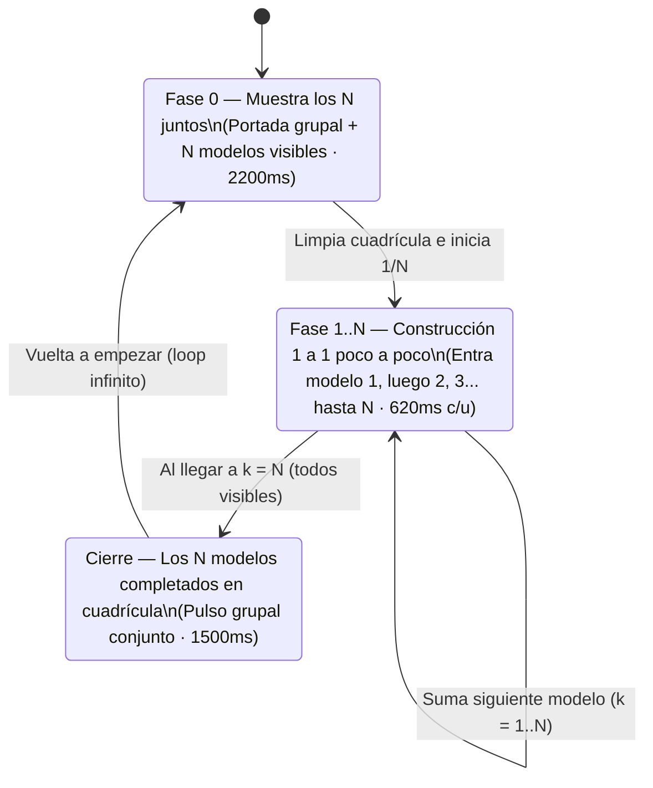

# Especificación SDD — Tarjetas Estilo Skala CRM + Motor de Animación Secuencial 1 a 1 en Distribuciones Ontiveros

> **Gobernanza Multiagente ([`AGENTS.md`](../../AGENTS.md)):**
> - **Fase actual:** Exploración, Arquitectura y Especificación SDD (**Argon 4**)
> - **Siguiente fase:** Implementación en código (`.js`, `.css`) y Certificación QA (**Claude**)

---

## 1. Diagnóstico Comparativo: Tarjeta `catalogo-skala` vs. `catalogo-distribuidora`

| Componente | Diseño en `catalogo-skala` (`main.js` + `styles.css`) | Estado actual en `catalogo-distribuidora` (`main-distribuidora.js`) | Mejora a aplicar en `catalogo-distribuidora` |
| :--- | :--- | :--- | :--- |
| **Cabecera (`.card-top`)** | Ubicada **arriba de la imagen**: `<h3 class="card-name">` a la izquierda y `.card-top-right` a la derecha (`.card-line` + iconos de curvatura). | No existe `.card-top`; el título, marca y descripción larga van apilados debajo de la imagen. | Incorporar `.card-top` arriba de `.card-img` con `<h3 class="card-name">` a la izquierda y `.card-top-right` a la derecha (`.card-line` de Marca/Categoría + chip compacto `📦 ×N`). |
| **Escenario de Imagen (`.card-img`)** | Proporción `4 / 3`, fondo `#FFFFFF`, `.card-badge` (izq), `.card-n` (der) y botón `.card-zoom` (abajo-der). | Muestra únicamente una imagen estática (`g.portada800`) con todos los productos juntos. | Convertir `.card-img` en un **Escenario Animado Multicapa (`.card-anim-stage`)** que primero muestra todos los modelos juntos (`g.portada800` / mosaico completo) y luego va mostrando **1 a 1 poco a poco** las imágenes individuales (`v.img400`) en cuadrícula hasta completar los $N$ modelos y volver a empezar. |
| **Tira de Variantes (`.frag-strip`)** | No aplica (Skala tiene 1 SKU por tarjeta). | Muestra mini-avatares estáticos (`.frag-avatar`). | Sincronizar `.frag-avatar` con la animación: cuando entra el modelo $k$ en la cuadrícula superior, su mini-avatar se ilumina/escala (`.is-active-anim`). |
| **Cuerpo Inferior (`.card-body`)** | Compacto y centrado: `.card-precio` (`<strong>$XX.XX</strong> / caja × 6`) + `.card-order` abajo. | Incluye párrafo largo `.card-benefit` y chips repetidos que alargan la tarjeta en móvil. | Limpiar y compactar `.card-body` al estilo Skala: `.frag-strip` sincronizada + `.card-precio` centrado con desglose Mayorista/Unidad + `.card-picked-list` + botón `.btn-abrir-fragancias`. |

---

## 2. Coreografía del Motor de Animación (`Primero los N → 1 a 1 poco a poco hasta mostrar los N → Vuelta a empezar`)

Para cada tarjeta `.card[data-group-card]` con $N \ge 2$ variantes (ej. **7 Detergentes Alive**, **5 Lavaplatos Aliclean**, **6 Suavizantes**, **4 Papeles Alisoft**, **16 Baños Skala**, etc.):

### 2.1. Detalle de Fases Visuales (Ejemplo: 7 Detergentes Alive `GRP-ALV-DET-1KG`)
1. **Fase 0 — «Primero muestra los 7» (`step = 0`, duración `2200 ms`):**
   - Se visualiza la composición grupal con los 7 detergentes juntos (`.anim-layer-all` activa y las 7 celdas de `.anim-layer-grid` visibles).
   - La píldora flotante `.card-anim-pill` (esquina inferior izquierda de `.card-img`) indica: `✨ Los 7 modelos`.
2. **Fase 1 a $N$ — «Luego va mostrando 1 a 1 poco a poco hasta mostrar los 7» (`step = 1..7`, `620 ms` por paso):**
   - Se oculta la capa de portada grupal y queda activa la cuadrícula dinámica `.anim-layer-grid` sobre fondo blanco `#FFFFFF`.
   - **Paso 1 (`k = 1`):** Se revela únicamente la celda `0` (*Blanco Perla Blanqueador*) con animación `pop-in` (`opacity: 1; transform: scale(1)` + realce `.is-just-added`), mientras las celdas `2..7` permanecen ocultas (`opacity: 0; transform: scale(0.68) translateY(8px)`). La píldora muestra `1/7 · Blanco Perla Blanqueador`.
   - **Paso 2 (`k = 2`):** La celda `0` queda visible y entra con animación la celda `1` (*Morado Floral*). Ahora se ven **2 detergentes**. La píldora muestra `2/7 · Morado Floral`.
   - **Paso 3 (`k = 3`):** Quedan visibles `0, 1` y entra la celda `2` (*Rosado con Suavizante*). Ahora se ven **3 detergentes**.
   - **Pasos 4, 5, 6 y 7:** Continúa sumando 1 a 1 hasta que en el **Paso 7 (`k = 7`)** entra *Azul Fragancia Bebé* y **quedan los 7 detergentes mostrados juntos en la cuadrícula**.
   - En cada paso $k$, el avatar correspondiente en `.frag-strip` (`.frag-avatar[data-avatar-idx="${k-1}"]`) recibe `.is-active-anim` y la barra `.card-anim-bar-fill` avanza a `(k / N) * 100%`.
3. **Pausa con los 7 Completos y Reinicio — «Hasta mostrar los 7 y vuelta a empezar» (`step = N + 1`, duración `1500 ms`):**
   - Con los 7 productos ya revelados en la cuadrícula, se aplica la clase `.is-complete-pulse` (realce suave de conjunto), la píldora muestra `✓ 7/7 modelos completos` y al terminar regresa suavemente a la **Fase 0** para repetir el ciclo.

---

## 3. Distribución Geométrica de la Cuadrícula Interna (`.anim-layer-grid[data-count]`)

Para que todos los envases dentro de `.card-img` (`aspect-ratio: 4 / 3`) aprovechen al máximo el espacio blanco de estudio sin deformarse (`object-fit: contain`):

- Utilizamos un contenedor `.anim-layer-grid` con `display: flex; flex-wrap: wrap; align-items: center; justify-content: center; align-content: center;` donde el ancho/alto de cada celda `.anim-cell` se calcula según `data-count`:
  - **`data-count="2"`** (ej. A-Z, Toallín): 2 por fila (`width: 48%; height: 86%`).
  - **`data-count="3"`** (ej. Panela, Baño Crema Alive, Harmony Milky, Toallas Húmedas): 3 en 1 fila (`width: 32%; height: 84%`).
  - **`data-count="4"`** (ej. Papel Alisoft, Lociones, Shampoo 250ml, Toallas Fem.): Cuadrícula 2×2 (`width: 47%; height: 47%`).
  - **`data-count="5"`** (ej. Lavaplatos Aliclean): 3 arriba y 2 centrados abajo (`width: 31%; height: 47%`).
  - **`data-count="6"`** (ej. Suavizantes, Jabón Anita, Harmony Fruity): Cuadrícula 3×2 (`width: 31%; height: 47%`).
  - **`data-count="7"`** (ej. Detergentes Alive 1kg y 500g, Shampoo 350ml, Pañales Baby Finger): **4 arriba y 3 centrados abajo** (`width: 23.5%; height: 47%`).
  - **`data-count="8"`** (ej. Kits Skala, Cuidado Bebé): Cuadrícula 4×2 (`width: 23.5%; height: 47%`).
  - **`data-count="10"`** (ej. Crema Dental Alident): Cuadrícula 5×2 (`width: 19%; height: 47%`).
  - **`data-count="16"`** (ej. Baños de Crema Skala 1kg): Cuadrícula 4×4 (`width: 23.5%; height: 23.5%`).

---

## 4. Archivos Objetivo y Criterios de Aceptación (QA)

1. **[`catalogo-distribuidora/js/main-distribuidora.js`](../../../catalogo-distribuidora/js/main-distribuidora.js)**:
   - Actualizar `cardGrupoHTML(g)` para adoptar la estructura de cabecera `.card-top` de `catalogo-skala` y renderizar dentro de `.card-img` el escenario `.card-anim-stage` con `.anim-layer-all`, `.anim-layer-grid` (con una `.anim-cell` por cada variante en `g.variantes`), `.card-anim-pill` y `.card-anim-bar`.
   - Agregar el motor `iniciarAnimacionesTarjetas()` gobernado por `IntersectionObserver` (solo anima tarjetas visibles en el viewport, se pausa si `document.body.classList.contains("modal-open")` o `prefers-reduced-motion: reduce`, y se re-vincula al final de `renderCatalog()`).
2. **[`catalogo-distribuidora/css/styles.css`](../../../catalogo-distribuidora/css/styles.css)**:
   - Añadir estilos de `.card-top`, `.card-top-right`, `.card-anim-stage`, `.anim-layer-all`, `.anim-layer-grid`, `.anim-cell` (estados `.is-visible`, `.is-just-added`, `.is-complete-pulse`), `.card-anim-pill`, `.card-anim-bar` y `.frag-avatar.is-active-anim`, preservando compatibilidad con `.modo-matriz` e impresión `@media print`.
3. **[`catalogo-distribuidora/tests/distribuidora.test.js`](../../../catalogo-distribuidora/tests/distribuidora.test.js)**:
   - Agregar prueba automatizada que verifique la presencia de `.card-top`, `.card-anim-stage`, `.anim-layer-grid`, `.anim-cell` y `iniciarAnimacionesTarjetas`, garantizando que las 5 suites pasen al 100% (`node --test`).
